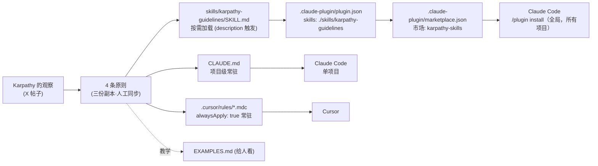

# Karpathy-Skills · LLM 编码行为准则解析

> 一个只有 **约 70 行 Markdown** 的「行为准则」包，把 Andrej Karpathy 对 LLM 写代码毛病的吐槽，
> 提炼成 **4 条原则**，再同时打包给 **Claude Code（Plugin / Skill / CLAUDE.md）** 和 **Cursor（Project Rule）**。
> 核心一句话：**它不给 Agent 增加任何能力，只给 Agent 加「刹车」和「验收标准」。**

---

## 1. 项目是做什么的

### 1.1 要解决的问题

项目源自 Karpathy 在 X 上的一条帖子（2026-01-26），他总结了当前编码模型的三类典型毛病：

| #   | Karpathy 原话（节选）                                                                                                                     | 本质问题                  |
| --- | ----------------------------------------------------------------------------------------------------------------------------------- | --------------------- |
| 1   | *"make wrong assumptions on your behalf and just run along with them without checking… don't seek clarifications… don't push back"* | **不澄清**：默默选一种理解一路狂奔   |
| 2   | *"overcomplicate code and APIs, bloat abstractions… 1000 lines when 100 would do"*                                                  | **过度设计**：抽象、配置项、猜测性功能 |
| 3   | *"change/remove comments and code they don't sufficiently understand as side effects"*                                              | **越界修改**：顺手重构、改注释、改风格 |

以及一条正向洞察：

> *"LLMs are exceptionally good at looping until they meet specific goals… Don't tell it what to do, give it success criteria and watch it go."*

### 1.2 它的作用

把上面 3 个问题 + 1 个洞察，一一对应成 4 条原则：

| 原则 | 对治 | 一句话 |
|---|---|---|
| **① Think Before Coding** | 不澄清、隐藏困惑、不给权衡 | 先想清楚、说出假设、不懂就问 |
| **② Simplicity First** | 过度设计 | 用最少的代码解决当下的问题 |
| **③ Surgical Changes** | 越界修改 | 只动必须动的，只清理自己的烂摊子 |
| **④ Goal-Driven Execution** | 命令式指令 → 无法自我验证 | 把任务改写成可验证的目标，循环直到通过 |

对 AI 架构师来说，它的价值不在内容多新（资深工程师都懂），而在于：

- **把「工程师素养」编码成模型可执行的约束**——是一份「System Prompt 级别的工程文化」。
- **一份内容，多端分发**：同一套准则同时适配 Claude Code 插件市场、项目级 `CLAUDE.md`、Cursor 规则。
- **可度量**：给出了「准则生效」的可观察指标（diff 更小、返工更少、提问前置）。

---

## 2. 项目包括哪些内容

```
andrej-karpathy-skills/
├── .claude-plugin/
│   ├── marketplace.json        # Claude Code 插件市场清单（市场名 karpathy-skills）
│   └── plugin.json             # 插件清单：声明 skills 目录
├── skills/
│   └── karpathy-guidelines/
│       └── SKILL.md            # ★ 核心：Agent Skill 版本（带 YAML frontmatter）
├── .cursor/
│   └── rules/
│       └── karpathy-guidelines.mdc   # Cursor 项目规则（alwaysApply: true）
├── CLAUDE.md                   # 项目级指令版本（可直接 curl 到任何项目）
├── CURSOR.md                   # Cursor 使用说明 + 贡献者同步规则
├── EXAMPLES.md                 # 522 行正反例：每条原则 2~3 个 ❌/✅ 对照
├── README.md / README.zh.md    # 中英文说明、安装方式
```

| 文件 | 规模 | 角色 |
|---|---|---|
| `SKILL.md` | 67 行 / 2.5KB | 准则本体（Skill 形态） |
| `CLAUDE.md` | 65 行 / 2.3KB | 准则本体（常驻指令形态） |
| `karpathy-guidelines.mdc` | 70 行 / 2.6KB | 准则本体（Cursor 规则形态） |
| `plugin.json` + `marketplace.json` | 11 + 29 行 | 分发元数据 |
| `EXAMPLES.md` | 522 行 | 「教学材料」——给人看，不加载给模型 |
| `README*.md` / `CURSOR.md` | 171 / 28 行 | 文档 |

> [!note] 关键观察
> 整个仓库**没有一行可执行代码**。它是一个纯「提示词资产」项目，工程量全在 **内容设计 + 分发适配**。

---

## 3. 项目架构

### 3.1 「一份内容，三种载体」



### 3.2 三种载体的差异（架构师要看懂的点）

| 维度 | Plugin → Skill | CLAUDE.md | Cursor `.mdc` |
|---|---|---|---|
| 作用范围 | 装一次，**所有项目** | 仅当前项目 | 仅当前项目 |
| 加载时机 | **按需**：模型看到 `description` 判断相关才读全文 | **常驻**：每次会话都在上下文里 | **常驻**：`alwaysApply: true` |
| 上下文成本（按字节 ÷ 4 估算） | 平时只占 description 一行 | 每次约 600 token | 每次约 650 token |
| 触发可靠性 | 依赖模型「想起来」调用 skill | 100%（总在上下文） | 100% |
| 与项目规则合并 | 独立存在 | 与项目自己的规则写在同一文件 | 与其他 rules 并列 |

> [!tip] 架构取舍
> - **行为准则类内容**本质上希望「永远生效」，所以常驻（CLAUDE.md / alwaysApply）其实比按需 Skill 更可靠。
> - Skill 形态的优势是**跨项目分发**和**省上下文**，代价是可能不被触发。
> - 所以作者把 `description` 写得很宽：*"Use when writing, reviewing, or refactoring code"*——几乎覆盖所有编码场景，尽量提高触发率。

### 3.3 分发链路：Plugin Marketplace 机制

1. `marketplace.json` 定义**市场**：`name: karpathy-skills`，内含一个插件 `andrej-karpathy-skills`，`source: "./"` 表示插件就在仓库根目录。
2. `plugin.json` 定义**插件**：`skills: ["./skills/karpathy-guidelines"]`，告诉 Claude Code 去哪找 Skill。
3. Skill 目录下的 `SKILL.md`：frontmatter 的 `name` / `description` 用于注册和触发，正文是注入给模型的指令。

安装命令里的 `andrej-karpathy-skills@karpathy-skills` 正好是 `插件名@市场名`。

### 3.4 一致性维护：人工同步（没有构建步骤）

`CURSOR.md` 的 *For contributors* 要求：改原则时**必须**手动同步 `CLAUDE.md` 和 `.mdc`；`SKILL.md` 则是「如果希望发布出去的文本一致，也要更新」——措辞更弱。这是个**典型的多副本漂移风险**。

用 `diff` 实测（commit 2c60614）：`CLAUDE.md` 与 `.mdc` 的正文除 H1 标题外**完全一致**；`SKILL.md` 与它们的差异如下：

| 差异点                                  | SKILL.md                   | CLAUDE.md | .mdc                      |
| ------------------------------------ | -------------------------- | --------- | ------------------------- |
| YAML frontmatter                     | `name/description/license` | 无         | `description/alwaysApply` |
| Karpathy 原帖链接                        | ✅                          | ❌         | ❌                         |
| 「Merge with project-specific instructions」 | ❌                     | ✅         | ✅                         |
| 末尾「These guidelines are working if…」 | ❌                          | ✅         | ✅                         |

> [!question] 改进思路（自己的思考）
> 若准则数量增多，可用一个源文件 + 简单脚本生成三种载体（或 CI 里 diff 校验正文一致），避免手工漂移。当前只有 4 条原则，手动同步也可以接受——这本身就是「Simplicity First」。

---

## 4. 逐行分析 SKILL.md

源文件：`skills/karpathy-guidelines/SKILL.md`，共 67 行。

### 4.1 Frontmatter（L1–L5）

```yaml
---
name: karpathy-guidelines
description: Behavioral guidelines to reduce common LLM coding mistakes. Use when writing, reviewing, or refactoring code to avoid overcomplication, make surgical changes, surface assumptions, and define verifiable success criteria.
license: MIT
---
```

| 行       | 内容                          | 分析                                                                                                                                                                                                    |
| ------- | --------------------------- | ----------------------------------------------------------------------------------------------------------------------------------------------------------------------------------------------------- |
| L1 / L5 | `---`                       | YAML frontmatter 边界。Agent Skills 规范要求 `SKILL.md` 以此开头。                                                                                                                                                |
| L2      | `name: karpathy-guidelines` | Skill 唯一标识，与目录名一致，调用时用这个名字。                                                                                                                                                                           |
| L3      | `description: ...`          | **整个 Skill 最关键的一行**。模型平时只看到这一行，决定是否加载全文。结构是「是什么 + Use when…（触发条件）+ 四个关键词」：`avoid overcomplication`（②）、`surgical changes`（③）、`surface assumptions`（①）、`verifiable success criteria`（④）。把四条原则都压进了触发描述里。 |
| L4      | `license: MIT`              | 许可证声明，可选字段。                                                                                                                                                                                           |

### 4.2 标题与定位（L7–L11）

```markdown
# Karpathy Guidelines

Behavioral guidelines to reduce common LLM coding mistakes, derived from [Andrej Karpathy's observations](...) on LLM coding pitfalls.

**Tradeoff:** These guidelines bias toward caution over speed. For trivial tasks, use judgment.
```

| 行   | 分析                                                                                                                               |
| --- | -------------------------------------------------------------------------------------------------------------------------------- |
| L7  | H1 标题。                                                                                                                           |
| L9  | 声明**来源与目的**："reduce mistakes"——定位是纠偏，不是教新技能。附原帖链接，增加权威性。                                                                         |
| L11 | **Tradeoff 声明——很有设计感的一行**。明确告诉模型：这套规则偏向「谨慎 > 速度」，但**琐碎任务自行判断**。作用是防止模型机械执行（比如改个错别字也先列 5 条假设再问用户），给了一个「逃生口」。好的 Prompt 会主动说出自己的代价。 |

### 4.3 原则 ① Think Before Coding（L13–L21）

```markdown
## 1. Think Before Coding

**Don't assume. Don't hide confusion. Surface tradeoffs.**

Before implementing:
- State your assumptions explicitly. If uncertain, ask.
- If multiple interpretations exist, present them - don't pick silently.
- If a simpler approach exists, say so. Push back when warranted.
- If something is unclear, stop. Name what's confusing. Ask.
```

| 行 | 分析 |
|---|---|
| L13 | 编号标题。数字编号暗示**执行顺序**：先想 → 再简化 → 再改 → 再验证。 |
| L15 | **三连祈使口号**（粗体）。每条原则都用「粗体口号 + 列表细则」的结构：口号便于模型记忆和概括，细则给出可执行动作。 |
| L17 | `Before implementing:`——限定**时机**：在写代码之前。 |
| L18 | 显式陈述假设；不确定就问。对治 Karpathy 的「wrong assumptions… without checking」。 |
| L19 | 存在多种理解时**列出来**，不要默默选。关键词 `silently`——问题不是选错，而是「选了但不说」。 |
| L20 | 有更简单方案要说，**该反驳时就反驳**（Push back）。对治模型的讨好倾向（sycophancy）。也是通往原则 ② 的桥。 |
| L21 | 不清楚就**停下 → 说出困惑点 → 提问**。三个短动作，给了「卡住时」的标准流程。 |

> [!example] EXAMPLES.md 对照
> 用户说「导出用户数据」：❌ 直接写 `export_users()` 导出全部用户到 `users.json`；✅ 先问范围（隐私）、形式（下载/后台任务/API）、字段、数据量，并给出最简方案建议。

### 4.4 原则 ② Simplicity First（L23–L33）

```markdown
## 2. Simplicity First

**Minimum code that solves the problem. Nothing speculative.**

- No features beyond what was asked.
- No abstractions for single-use code.
- No "flexibility" or "configurability" that wasn't requested.
- No error handling for impossible scenarios.
- If you write 200 lines and it could be 50, rewrite it.

Ask yourself: "Would a senior engineer say this is overcomplicated?" If yes, simplify.
```

| 行 | 分析 |
|---|---|
| L25 | 口号核心词：`speculative`（投机性、猜测性的）。瞄准「为未来需求提前设计」。 |
| L27 | 不做需求以外的功能（YAGNI）。 |
| L28 | 只用一次的代码不抽象。对治「策略模式算一个折扣」这类过度设计。 |
| L29 | 没被要求的「灵活性 / 可配置性」不加。引号是在讽刺模型爱说的这两个词。 |
| L30 | **不为不可能的场景写错误处理**。模型很爱给每行包 try/except，这条专门压制。 |
| L31 | 给出**量化锚点**：200 行能写成 50 行就重写。抽象原则 + 具体数字，模型更容易执行。 |
| L33 | **自检问题**：「资深工程师会觉得过度复杂吗？」——用一个角色视角做 self-review，比规则列表更泛化。 |

> [!example] EXAMPLES.md 对照
> 「把用户偏好存到数据库」：❌ 写出带 cache/validator/merge/notify 的 `PreferenceManager` 类；✅ 一个只有几行的函数 `save_preferences()`，一条 `UPDATE` 语句，并注明「缓存、校验、合并等需要时再加」。

### 4.5 原则 ③ Surgical Changes（L35–L49）

```markdown
## 3. Surgical Changes

**Touch only what you must. Clean up only your own mess.**

When editing existing code:
- Don't "improve" adjacent code, comments, or formatting.
- Don't refactor things that aren't broken.
- Match existing style, even if you'd do it differently.
- If you notice unrelated dead code, mention it - don't delete it.

When your changes create orphans:
- Remove imports/variables/functions that YOUR changes made unused.
- Don't remove pre-existing dead code unless asked.

The test: Every changed line should trace directly to the user's request.
```

| 行 | 分析 |
|---|---|
| L37 | 口号两半：**范围**（只动必须动的）+ **责任**（只清理自己制造的烂摊子）。 |
| L39 | 场景一：编辑已有代码。 |
| L40 | 不「改进」相邻代码/注释/格式。`"improve"` 加引号——模型眼中的改进，对 reviewer 是噪音。 |
| L41 | 没坏的不重构。 |
| L42 | **匹配现有风格**，即使你不喜欢。对治「风格漂移」（单引号改双引号、加类型注解）。 |
| L43 | 发现无关死代码：**说出来，不要删**。把决定权交还给人——知情但不越权。 |
| L45 | 场景二：你的改动产生了孤儿代码。 |
| L46 | 你的改动导致没用的 import/变量/函数，**你要删**。`YOUR` 大写强调归属。 |
| L47 | 原本就存在的死代码，除非被要求，不删。与 L46 形成边界清晰的对称规则。 |
| L49 | **验收标准：每一行改动都能追溯到用户请求**。这是一个 diff 级别可检查的判据，也是整套准则里最好用的一条 review 标准。 |

> [!example] EXAMPLES.md 对照
> 「修复空 email 导致校验器崩溃」：❌ 顺手增强 email 校验、加用户名长度校验、改注释、加 docstring；✅ 只改判空那两行。

### 4.6 原则 ④ Goal-Driven Execution（L51–L67）

```markdown
## 4. Goal-Driven Execution

**Define success criteria. Loop until verified.**

Transform tasks into verifiable goals:
- "Add validation" → "Write tests for invalid inputs, then make them pass"
- "Fix the bug" → "Write a test that reproduces it, then make it pass"
- "Refactor X" → "Ensure tests pass before and after"

For multi-step tasks, state a brief plan:
1. [Step] → verify: [check]
2. [Step] → verify: [check]
3. [Step] → verify: [check]

Strong success criteria let you loop independently. Weak criteria ("make it work") require constant clarification.
```

| 行 | 分析 |
|---|---|
| L53 | 口号：定义成功标准 → 循环直到验证通过。直接对应 Karpathy 的「give it success criteria and watch it go」。 |
| L55 | 核心动作：把**命令式任务**改写成**可验证目标**。 |
| L56 | 「加校验」→ 先写非法输入测试，再让它通过（TDD）。 |
| L57 | 「修 bug」→ 先写**复现测试**，再修。保证「修的确实是那个 bug」。 |
| L58 | 「重构」→ 前后测试都通过。重构的定义就是「行为不变」，测试就是行为的契约。 |
| L60 | 多步任务先给简短计划。 |
| L61–L65 | **计划模板**：每一步都绑定 `verify: [check]`。把「计划」和「验收」绑在同一行，是这条原则的精髓——没有验证手段的步骤不算步骤。 |
| L67 | 解释**为什么**：强标准让 Agent 能**独立循环**；弱标准（"make it work"）只能不停回头问人。这句话把原则 ④ 和原则 ① 联系起来：前者减少不必要的提问，后者保证必要的提问。 |

> [!note] SKILL.md 与 CLAUDE.md 的差别
> CLAUDE.md 在 L67 之后还有一段「These guidelines are working if: fewer unnecessary changes in diffs, fewer rewrites due to overcomplication, and clarifying questions come before implementation」——这是给人的**效果度量**，SKILL.md 版本省略了。

### 4.7 写作手法总结（可迁移到自己写 Skill）

| 手法 | 在本 Skill 中的体现 |
|---|---|
| 口号 + 细则两层结构 | 每条原则一句粗体口号 + 4~5 条可执行动作 |
| 否定式清单 | `No… / Don't…` 精确压制模型的已知坏习惯 |
| 量化锚点 | 「200 行 → 50 行」 |
| 角色化自检 | 「资深工程师会觉得复杂吗？」 |
| 可检查的验收判据 | 「每行改动可追溯到请求」「verify: [check]」 |
| 主动声明代价 | Tradeoff 行：谨慎优先，琐碎任务自行判断 |
| 触发词覆盖 | description 同时覆盖写/审/重构三种场景和四个原则关键词 |
| 极简 | 全文 < 3KB，常驻也几乎没有上下文负担 |

---

## 5. 怎么使用

### 5.1 方式 A：Claude Code 插件（推荐，全局生效）

```text
/plugin marketplace add forrestchang/andrej-karpathy-skills
/plugin install andrej-karpathy-skills@karpathy-skills
```

装好后所有项目都能用 `karpathy-guidelines` 这个 Skill；模型会根据 description 在编码相关任务中自动加载，也可以在提示中直接点名让它用这个 skill。

> 仓库已迁移到 `multica-ai/andrej-karpathy-skills`，旧地址一般会被 GitHub 自动重定向。

### 5.2 方式 B：CLAUDE.md（单项目，常驻生效）

```bash
# 新项目
curl -o CLAUDE.md https://raw.githubusercontent.com/forrestchang/andrej-karpathy-skills/main/CLAUDE.md

# 已有 CLAUDE.md，追加
echo "" >> CLAUDE.md
curl https://raw.githubusercontent.com/forrestchang/andrej-karpathy-skills/main/CLAUDE.md >> CLAUDE.md
```

再在后面追加项目自己的规则：

```markdown
## Project-Specific Guidelines
- Use TypeScript strict mode
- All API endpoints must have tests
- Follow the existing error handling patterns in `src/utils/errors.ts`
```

### 5.3 方式 C：Cursor

- 本仓库：打开即生效（`.cursor/rules/karpathy-guidelines.mdc` 带 `alwaysApply: true`），可在 **Settings → Rules** 确认。
- 其他项目：把 `.mdc` 拷到目标项目的 `.cursor/rules/`。
- 个人技能：把 `SKILL.md` 拷贝或软链到 `~/.cursor/skills/`。
- 注意：Cursor **默认不读** `.claude-plugin/` 和 `CLAUDE.md`。

### 5.4 怎么判断它生效了

- diff 里只出现被要求的改动
- 因过度复杂导致的返工变少
- 澄清问题出现在**写代码之前**，而不是出错之后
- PR 干净、最小，没有「顺手改进」

### 5.5 选型建议

| 场景 | 推荐方式 |
|---|---|
| 个人全局使用 Claude Code | 插件（A） |
| 团队项目，需要所有人/所有 Agent 一致 | CLAUDE.md（B），提交进仓库 |
| 团队混用 Claude Code + Cursor | B + C 同时提交 |
| 想要「一定生效」 | 常驻载体（B/C）优于按需 Skill |

---

## 6. 架构师视角的补充思考

### 6.1 它在 Agent 系统中的位置

在一个编码 Agent 的指令栈里，大致分层为：

```
平台 System Prompt（厂商）
  └─ 全局行为准则  ← Karpathy-Skills 在这一层（跨项目的工程文化）
      └─ 项目规则（CLAUDE.md 中的 Project-Specific）
          └─ 领域 Skill（如 [[Reverse-Skill · 逆向安全技能路由系统架构解析]] 的专家 skill）
              └─ 当前任务指令
```

它与 Reverse-Skill 这类「路由 + 领域方法论」项目**正交、可叠加**：一个决定「做什么、用什么工具」，一个约束「怎么做才不越界」。

### 6.2 局限与风险

- **没有强制力**：纯提示词，依赖模型遵从；长上下文后期可能被「稀释」。需要配合 hooks、CI、代码审查做硬约束。
- **「不确定就问」与无人值守场景冲突**：在自动化 / 后台 Agent 中没人回答问题。实践中应改为「说出假设 → 选最合理的一种 → 在输出里显式标注」。
- **原则间存在张力**：①要多问，④要自主循环。平衡点是「目标不清就问，目标清楚就自己循环验证」。
- **③ 可能与团队期望冲突**：有的团队希望 Agent 顺手修 lint 问题，应在项目规则里显式覆盖。
- **多副本漂移**：见 3.4。
- **教学材料本身也可能违反准则**：见 6.4。

### 6.3 可以借鉴到自己团队的做法

1. 把团队 code review 里反复出现的意见，整理成「口号 + 否定清单 + 验收判据」形式，写进 `CLAUDE.md`。
2. 每条规则配一个 ❌/✅ 对照例子（像 EXAMPLES.md），给人培训用，**不必**塞给模型。
3. 用「每行改动可追溯到需求」作为 AI 生成 PR 的 review checklist 第一条。
4. 给 Agent 下任务时，用原则 ④ 的模板写提示：`步骤 → verify: 检查方式`。

### 6.4 勘误：EXAMPLES.md 里一个「复现不了 bug」的复现测试

原则 ④ 的 Example 3（*Test-First Verification*，EXAMPLES.md L454–L496）要演示「先写复现测试，再修 bug」：

- 用户报告：分数相同时排序结果不稳定。
- ✅ 版的测试只断言了 `score` 字段：`100, 100, 90`。
- 但两个 100 分的人（Alice、Bob）**谁排前面，这三条断言都检查不到**。只要按分数降序排，这个测试永远通过，注释里的「跑 10 次 → 因为顺序不一致而失败」不可能发生。
- 另外，❌ 版和 ✅ 版的 `sort_scores` 代码**一字不差**，差别只在「有没有先写测试」。

要真正复现，断言应该检查同分时的次序，例如 `assert [r['name'] for r in result] == ['Alice', 'Bob', 'Charlie']`。

> [!warning] 启发
> 这恰好说明原则 ④ 的难点：**测试必须能在 bug 存在时失败**，否则「先写测试」只是形式。写复现测试后，应先确认它在修复前是红的——这一步本身就是 `verify: [check]`。

---

## 附：一句话记忆点

> **先问清楚（Think）→ 写最少（Simple）→ 只改该改的（Surgical）→ 用测试说话（Goal-Driven）。**
> 好代码是**简单地解决今天的问题**，而不是**提前解决明天的问题**。
