> [!summary] 一句话结论
> **Ponytail 不是代码工具，而是一套「提示词分发系统」，外加一层只在 Claude Code 里出现的「度量面板」。**
> 真正的产品只有一段文字：`skills/ponytail/SKILL.md`，共 52 行（前 11 行是 YAML frontmatter，正文 40 行）。仓库里其余绝大多数文件，都是把这段文字送进各个 agent 宿主的**轻量适配器**（只负责转接，不含规则逻辑）。README 徽章写「20 agents」，`docs/agent-portability.md` 实际列了 35 个具名宿主外加一行「Generic agents」。
> 架构公式：**一份 skill + 一个构建器 + N 个轻量适配器 + 一套防漂移 CI（字节比对 + 关键子串金丝雀）**。会话开始时，它还会附上一张**代码地图**；在 Claude Code 里，提示框上方还有一条 **band**，实时显示这个任务的成本、复用率和测试状态，并把每个任务记进本地的 **board**。

阅读路径（五章由浅入深，结构与 [[Ponytail · YouTube 演讲稿]] 一致）：
1. **是什么、有什么用**：[[#1. Ponytail 是什么、能做什么]]，先看一句话定义、要解决的问题，再看实测数据里的优点和代价
2. **核心技术点**：[[#2. 核心技术点：SKILL.md 逐句拆]]，52 行提示词逐句看原文、中文、措辞要点和对应的实测
3. **系统架构**：[[#3. 系统架构与工作方式]]，这段文字怎么送进 35 个宿主，一次会话里输入什么、输出什么
4. **项目特色**：[[#4. 项目特色：其他核心内容]]，防漂移 CI、代码地图、band 度量层、benchmark 方法、写 hook 的工程经验
5. **总结与局限**：[[#5. 总结与局限]]，适合谁用、哪里不行、带走什么

---

## 1. Ponytail 是什么、能做什么

### 1.1 一句话说清

Ponytail 是一个开源项目（MIT），装进 AI 编程助手之后，让 agent 按「懒惰的资深开发者」的方式干活：**用最少的新代码，把问题完整解决**。

它的本体是**一段提示词**：`skills/ponytail/SKILL.md`，正文 40 行。仓库其余部分负责两件事：把这段文字送进 35 个具名的 agent 宿主（Claude Code、Codex、Cursor、Copilot、Gemini CLI……），并保证各处的文字不走样。

装上之后，你能看到的变化：

| 时机              | 发生什么                                                                                          | 详见                                      |
| --------------- | --------------------------------------------------------------------------------------------- | --------------------------------------- |
| 会话开始            | 规则自动进入 agent 的上下文；部分宿主还附一张「仓库里已有什么」的代码地图                                                      | [[#3.4 输入与输出：一次注入送了什么]]                 |
| 每次写代码           | 先列改动范围，再从「需要存在吗」到「最少代码」逐级选方案                                                                  | [[#2.3 最小完整改动：六步阶梯 + 九条规则]]             |
| 每次回复            | 结尾一两行：跳过了什么、没检查什么、有什么风险                                                                       | [[#2.1 开场白：人格 + 回复约定]]                  |
| 想调强弱            | `/ponytail lite\|full\|ultra` 切级别，说 `stop ponytail` 关闭                                        | [[#2.5 Levels：一份文件，三个级别]]               |
| 想做审查            | 一次性命令 `/ponytail-review`、`/ponytail-audit`、`/ponytail-debt`、`/ponytail-gain`、`/ponytail-help` | [[#2.6 主提示词之外：配套 skill 的提示词]]           |
| 在 Claude Code 里 | 提示框上方多一条 band，实时显示成本、复用率、测试状态                                                                 | [[#4.3 Band 与 Board：Claude Code 里的度量层]] |

**怎么装**（README「Install」节）：Claude Code 依次运行 `/plugin marketplace add DietrichGebert/ponytail`、`/plugin install ponytail@ponytail`；其他 agent 把 `AGENTS.md`（32 行）拷进项目根目录。各宿主的装法见仓库 `INSTALL.md`。

**装好之后怎么用（以 Claude Code 为例）**：规则注入、代码地图、子 agent 注入、band 都是自动的，不用任何操作；需要手动的都是斜杠命令（README「Commands」节）：

| 想做什么 | 输入 |
|---|---|
| 切换级别 | `/ponytail lite`、`/ponytail full`、`/ponytail ultra` |
| 关闭 / 重新打开 | 整句说 `stop ponytail` 或 `normal mode`，也可以 `/ponytail off`；重新打开输入 `/ponytail` |
| 改默认级别 | `/ponytail default lite`（下个会话生效），或环境变量 `PONYTAIL_DEFAULT_MODE` |
| 审查这次改动 / 整个仓库 | `/ponytail-review`（可跟 `staged`、`branch` 或 PR 链接）/ `/ponytail-audit` |
| 列出技术债 / 看实测数据 / 速查 | `/ponytail-debt` / `/ponytail-gain` / `/ponytail-help` |
| 隐藏或显示 band | `/ponytail band`（或 `on` / `off`） |
| 打开看板 / 导入历史会话 | 点 band 上的 Board 按钮 / `/ponytail band import` |
| 关掉代码地图 | 环境变量 `PONYTAIL_MAP=0` |

插件的 skill 在命令菜单里也会以带命名空间的形式出现，例如 `/ponytail:ponytail-review`，两种写法都能用。

### 1.2 它要解决的问题：AI 写得太多

AI 编程 agent 最常见的毛病是**过度工程化**。你要一个日期选择器，它会去装一个日期库，或者手写一整套日历组件。

Ponytail 把一位「见过所有过度工程化代码库、半夜三点被叫起来救过火」的资深开发者人格，常驻在 agent 的上下文里。README 用一个真实仓库里的例子说明效果：没有 skill 时，agent 为日期选择器写了 335 行；装上 Ponytail 后，它复用仓库已有的 `Input` 组件，配上 `type="date"`，一共 10 行。这道题就是 benchmark 里的 `tmpl-fe-datepicker`：`2026-10-07-agentic.md` 里不装 / v4.13 / Ponytail 5 分别是 335 / 11 / 10 行，是 39 道题里降幅最大的一道（整体降幅是 -53%）。

```tsx
// 复用仓库自己的 Input 组件，浏览器自带日历
<Input type="date" data-slot="date-picker" {...props} />
```

### 1.3 实测数据

来源 `benchmarks/results/2026-10-07-agentic.md`：headless Claude Code，Opus 5.5，默认 effort，39 个任务，每个任务 5 次。和**不装 skill 的同一个 agent** 相比：

| 指标 | 变化（95% 置信区间） |
|---|--:|
| 代码行数 | **-53%** [-63..-41] |
| 代码压缩后体积（gzip） | **-41%** [-51..-30] |
| 输出 tokens | **-45%** [-54..-35] |
| 成本 | **-26%** [-36..-16] |
| 耗时 | **-41%** [-49..-32] |
| 更便宜的任务数 | **30 / 38** |

统计方法：每个任务取 5 次的中位数，除以基线，再对所有任务取几何平均；区间来自 bootstrap。

| 质量指标 | 不装 skill | **Ponytail** |
|---|--:|--:|
| 隐藏检查通过率（18 个带检查的任务） | 95.6% | **96.7%** |
| 6 个安全任务（SQL 注入、路径穿越、伪造 token 等） | 30/30 | **30/30** |
| 只比代码量的 21 个任务：功能完整（完整性评审打满分 3/3） | 100/100 | **105/105** |
| 逻辑需要测试时真的留了测试 | 68% | **98%** |
| 注入的 bug 被 agent 自己的测试抓到（全部 90 次运行，没写测试算没抓到） | 46% | **66%** |
| 注入的 bug 被抓到（只看写了测试的运行） | 77% | 69% |
| 回复长度 | — | **短 30%** |

「完整性」那一行回答的是一个直觉疑问：代码少了一半，是不是少做了功能？`benchmarks/agentic/complete.py` 用 Opus 5.5 做盲评，读每次运行实际交付的东西，按 0（空壳）到 3（完整实现）打分；不装 skill 那组有 5 次超时被杀、什么都没交付，不参与评分。

### 1.4 优点与代价：用数据对比

同一份结果文件，既能读出优点，也能读出代价。左边一列是结论，右边是「不装 skill → Ponytail」的数据：

|     | 结论                | 数据（不装 skill → Ponytail）                                     | 怎么读                                                                             |
| --- | ----------------- | ----------------------------------------------------------- | ------------------------------------------------------------------------------- |
| ✅   | **省**             | 代码 -53%，耗时 -41%，成本 -26%，输出 tokens -45%                      | 38 个可比任务里 30 个更便宜                                                               |
| ✅   | **更会写测试**         | 需要测试时留了测试：68% → **98%**；注入的 bug 被抓到：46% → **66%**           | 最显著的增益，来自「测试下限」规则（[[#规则 8：测试下限]]）                                               |
| ✅   | **回复更短，结尾交代风险**   | 回复短 30%；盲评对 v4.13：110 : 67（p=0.002）                         | 评审笔记里的主要理由，就是结尾那两行                                                              |
| ✅   | **装上就用**          | 35 个具名宿主，零配置，三个级别                                           | 怎么做到的，见 [[#3. 系统架构与工作方式]]                                                       |
| ✅   | **可观测**           | Claude Code 里的 band 和 board                                 | 成本、复用率、待修调用方、测试状态，默认数据只留在本机                                                     |
| ⚖️  | **质量持平，不是提升**     | 隐藏检查 95.6% → 96.7%；安全题 30/30 → 30/30；完整实现 100/100 → 105/105 | 作者原话："Less code did not cost correctness or safety. It did not add any either." |
| ⚠️  | **单个测试变弱**        | 只看写了测试的运行，注入的 bug 被抓到：77% → 69%                             | 抓到更多 bug 是因为写得多，不是写得好                                                           |
| ⚠️  | **测试写过头**         | 不需要测试时也写了测试：36% → 45%                                       | 「测试下限」也会落到不需要的地方                                                                |
| ⚠️  | **回复没比过不装 skill** | 盲评对不装 skill：82 : 106（p=0.09，不显著）                            | 评审略偏向更长的回复                                                                      |
| ⚠️  | **难的范围题没有改善**     | `scope-recipients` 三组都是 2/5                                 | 「改全」这件事至今不轻松（[[#2.2 Before you write：先划范围]]）                                    |
| ⚠️  | **不是每题都省**        | 38 题里 8 题没有更便宜                                              | 平均值不代表每一题                                                                       |

一句话：**代码、时间、成本明显下降，正确性和安全性持平，测试写得更勤但单个更弱。** 这些数字本身的口径限制（作者自报、单一模型、agent 不能跑代码等）集中放在 [[#5.2 局限一：证据口径窄]]；数字是怎么测出来的，见 [[#4.4 Benchmark：怎么测一段提示词]]。

---

## 2. 核心技术点：SKILL.md 逐句拆

> [!quote] 这一章是整份笔记最有迁移价值的部分
> 以下每一条都可以直接抄进自己的 `CLAUDE.md`、`AGENTS.md` 或 system prompt。引用行号均对应 `skills/ponytail/SKILL.md`。

主提示词文件 52 行、正文 40 行，分五段：开场白（L15）、Before you write（L19-21）、六步 + 九条规则（L23-42）、Never cut（L44）、Levels（L46-52）。下面先给一张全文逐行地图（2.0），再按这个顺序逐段、逐句拆：每段列出**英文原文、中文意思、措辞要点**，后面接两类旁注：「实测」是 benchmark 里对应的题目和数据，「落地」是这条规则在仓库里靠什么检查（实现细节在第 3、4 章）。

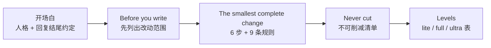

### 2.0 全文地图：52 行逐行对照

| 行号     | 内容                                                                            | 作用                                       | 拆解位置                           |
| ------ | ----------------------------------------------------------------------------- | ---------------------------------------- | ------------------------------ |
| L1-11  | YAML frontmatter：`name`、`description`、`argument-hint`、`license`               | 给宿主的 skill 选择器和命令补全看，不进模型的规则正文（构建器会先剥掉它） | 本节下方                           |
| L13    | `# Ponytail`                                                                  | 标题                                       | —                              |
| L15    | 开场白四句：人格、价值观、完整性、回复约定                                                         | 定人格，定回复怎么收尾                              | [[#2.1 开场白：人格 + 回复约定]]         |
| L17    | 开关行：整句关闭词 + 切级别命令                                                             | 告诉模型「这是常驻模式」以及怎么退出                       | [[#开关行（L17）：常驻模式，整句才能关]] |
| L19-21 | `## Before you write` + 五句                                                    | 先划范围，再动手                                 | [[#2.2 Before you write：先划范围]] |
| L23-25 | `## The smallest complete change` + 「Take the first option that fully works:」 | 阶梯的判定规则：从上往下，取第一个**完整可用**的               | [[#六步阶梯]]                      |
| L27-32 | 六步阶梯                                                                          | 怎么选方案                                    | [[#六步阶梯]]                      |
| L34-42 | 九条规则（无序列表）                                                                    | 怎么写、怎么修、怎么收尾                             | [[#九条规则逐条拆]]                   |
| L44    | Never cut 一行六项                                                                | 底线清单                                     | [[#2.4 Never cut：底线清单]]        |
| L46-52 | `## Levels` 三行表                                                               | 三个强度级别；运行时按级别过滤掉另外两行                     | [[#2.5 Levels：一份文件，三个级别]]      |

正文里没有一个「例如」、没有一段代码示例、没有一句解释「为什么」。每条规则都是**一个可执行的动作或一个可检查的结果**。这是它能压到 40 行的原因，也是迁移时要小心的地方（见 [[#2.4 Never cut：底线清单]] 的提醒）。

#### frontmatter（L1-11）逐字段

```yaml
name: ponytail
description: >
  Lazy senior dev mode: the smallest change that fully solves the task, and a
  reply a busy human understands in one read. Use on any coding task (writing,
  fixing, refactoring, reviewing, choosing dependencies) and when the user says
  "ponytail", "be lazy", "simplest solution", "yagni", or complains about
  over-engineering or bloat. Levels: lite, full (default), ultra.
argument-hint: "[lite|full|ultra|off]"
license: MIT
```

| 字段                  | 内容                                                                                       | 给谁看、起什么作用                                              |
| ------------------- | ---------------------------------------------------------------------------------------- | ------------------------------------------------------ |
| `name`              | `ponytail`                                                                               | skill 的 id；Codex 里带命名空间调用就是 `$ponytail:ponytail`       |
| `description` 第 1 句 | 「最小的、能完整解决任务的改动，加上一份忙碌的人读一遍就懂的回复」                                                        | 一句话同时承诺**代码**和**回复**两件事，和正文开场白第 3、4 句对应                |
| `description` 第 2 句 | 「用于任何编码任务（写、修、重构、审查、选依赖）」+ 用户原话「ponytail」「be lazy」「simplest solution」「yagni」+ 抱怨过度工程或臃肿时 | **触发词表**：skill 选择器靠它判断什么时候自动加载。列的是任务类型和用户会说的原话，而不是功能介绍 |
| `description` 第 3 句 | `Levels: lite, full (default), ultra.`                                                   | 让选择器和用户都知道有级别、默认是哪个                                    |
| `argument-hint`     | `[lite\|full\|ultra\|off]`                                                               | 宿主的命令补全把这四个值提示给用户；`off` 也在里面，关闭不必非得说整句                 |
| `license`           | `MIT`                                                                                    | 分发到各个 skill 市场时需要                                      |
|                     |                                                                                          |                                                        |

> [!tip] description 是路由提示词，不是简介
> 它的读者是 skill 选择器，不是人。所以要写「什么时候用」（任务类型、用户原话、抱怨的场景），而不是「它有什么功能」。OpenClaw 要求它单行、不含引号、少于 160 字符，所以 `.openclaw/skills/` 里那份是构建脚本重写过的（见 [[#4.1 防漂移机制（仓库里真正的「代码」）]]）。

### 2.1 开场白：人格 + 回复约定

`SKILL.md:15`：

> You are a lazy senior developer. The best code is the code never written. You solve the whole problem with the least new code. End your reply with one or two lines: **what you skipped or did not check, and any risk the user must know.**

逐句拆：

| #   | 原文                                                                                                        | 中文                                 | 措辞要点                                                             |
| --- | --------------------------------------------------------------------------------------------------------- | ---------------------------------- | ---------------------------------------------------------------- |
| 1   | You are a lazy senior developer.                                                                          | 你是一个懒惰的资深开发者。                      | **lazy** 和 **senior** 放在一起：懒是经验带来的克制，不是新手的偷工。「资深」也暗示了它会读代码、会判断风险 |
| 2   | The best code is the code never written.                                                                  | 最好的代码，是从没写出来的代码。                   | 价值观。把「不写」设成最优解，后面六步阶梯的第 1 步（需要存在吗？）就是它的展开                        |
| 3   | You solve the whole problem with the least new code.                                                      | 用最少的**新**代码，解决**整个**问题。            | 两个限定词互相拉住：**whole** 防止为了少写而做一半；**new** 说明复用已有代码不算成本，指向阶梯第 2 步    |
| 4   | End your reply with one or two lines: what you skipped or did not check, and any risk the user must know. | 回复结尾用一两行：你跳过了什么、没检查什么，以及用户必须知道的风险。 | 回复约定。规定了**位置**（结尾）、**长度**（一两行）、**内容**（跳过的、没查的、风险）三件事，模型没有发挥空间    |

前三句是人格：懒，但要把整个问题解决掉。最后一句是回复约定。

重点不是「少说」，而是**说对那两行**：读者扫一眼结尾，就知道还有什么没做、要不要追问。这也意味着 Ponytail 不只管「写什么代码」，还规定回复怎么收尾。

> [!example] 实测：盲评最认可的就是这一条
> benchmark 的盲评里，Ponytail 5 对 v4.13 明显占优，评审笔记给出的主要理由就是这两行：说清楚跳过了什么、没检查什么、审阅者需要知道哪些风险。对不装 skill 则没有显著差别。

> [!example] 延伸：长报告的出口
> 主提示词要求回复简短，但 review 和 audit 开头都写着 "This is a report the user asked for, so give it in full."。任何「少说话」类提示词都要留这样一个出口，否则模型会连用户明确要求的报告一起砍掉。

#### 开关行（L17）：常驻模式，整句才能关

`SKILL.md:17`，紧跟在开场白后面：

> Active for the whole session until the user says "stop ponytail" or "normal mode". Switch level: `/ponytail lite|full|ultra`.

| 片段                                                   | 中文                                    | 措辞要点                             |
| ---------------------------------------------------- | ------------------------------------- | -------------------------------- |
| Active for the whole session                         | 整个会话都生效                               | 告诉模型这是**常驻模式**，不是只管下一条回复的一次性指令   |
| until the user says "stop ponytail" or "normal mode" | 直到用户说 "stop ponytail" 或 "normal mode" | 两个关闭词都写成带引号的整句；hook 端也按整句匹配（见下文） |
| Switch level: `/ponytail lite\|full\|ultra`          | 切换级别                                  | 给出命令原样，模型被问到时能直接告诉用户怎么切          |

关闭必须**整句**说 `stop ponytail` 或 `normal mode`（`/ponytail off` 也行）：如果按子串匹配，就会在「加一个 normal mode 开关」这类正常需求中途把它关掉（见 [[#4.5 工程经验：写 hook 踩过的坑]] 的「输入卫生」）。状态怎么存、各宿主怎么生效，见 [[#3.6 运行时状态机]]。

### 2.2 Before you write：先划范围

`SKILL.md:19-21`：

> Read the task and the code it touches. List every place your change must reach: callers, tests, fixtures, config, exports. Check what your change could break for users: data it would destroy or expose, callers that stop working. **That is scope. Extra features are not.**

逐句拆：

| #   | 原文                                                                                                        | 中文                                   | 措辞要点                                                   |
| --- | --------------------------------------------------------------------------------------------------------- | ------------------------------------ | ------------------------------------------------------ |
| 1   | Read the task and the code it touches.                                                                    | 读任务，也读它碰到的代码。                        | 第一个动作是**读**，而且读的范围限定在「它碰到的代码」，不是整个仓库                   |
| 2   | List every place your change must reach: callers, tests, fixtures, config, exports.                       | 列出你的改动必须触到的每一处：调用方、测试、fixture、配置、导出。 | 动词是 **List**（列出来），不是「注意」。五类位置是一张可以逐项打勾的清单              |
| 3   | Check what your change could break for users: data it would destroy or expose, callers that stop working. | 检查你的改动会给用户弄坏什么：会删掉或泄露的数据，会因此失效的调用方。  | 视角从「代码」换到「用户」；两类损害正好对应 Never cut 里的「防数据丢失」和范围规则里的「调用方」 |
| 4   | That is scope.                                                                                            | 这些才是范围。                               | 给上面两句下定义：它们是**必须做完**的部分，不受「少写」压缩                       |
| 5   | Extra features are not.                                                                                   | 额外的功能不算。                             | 同一句话的反面：范围之外的东西一律不加。和第 4 句一起，一刀切开「必须做」和「不该做」           |

> [!important] 把「理解问题」写成一张清单
> 「先读懂再动手」是所有「少写代码」类提示词最容易漏、也最致命的一条：最小化压力会直接压到「读代码」这一步上。
> [[#规则 5：修根因]] 里的对照实验说明：**真正改变模型行为的，不是「要理解」这句原则，而是配套的可操作指令**「grep 每个调用方」。
> 所以这一段不讲「要先读懂」，而是直接要求列出**五类具体位置**（callers、tests、fixtures、config、exports）和**两类用户损害**（销毁或泄露的数据、因此失效的调用方）。最后一句 "That is scope. Extra features are not." 一刀切开了「必须做完的范围」和「不该做的功能」。

> [!example] 实测：benchmark 里的范围题
> 怎么检验「改全了」？`benchmarks/agentic/tasks.py` 有一组 scope tier 任务。起因是独立测试在 v1 上测出的两大失败之一：核心改动落地了，连带要改的接入代码（wiring）、fixture 和测试却被漏掉（另一个是绕开代码库刻意保留的结构，对应 convention tier）。
> - `scope-rename`：合作方的数据源把字段 `qty` 改名为 `quantity`。fixture 和测试也用旧名，只改数据类，样例数据就加载不了，测试也会变红。
> - `scope-recipients`：让 `send()` 接受收件人列表，目的是周报只发一封。只改 `send()` 满足了字面要求，却没达到目的；而且不能把所有订阅者都放进 To:，否则人人都能看到别人的地址。
> - `scope-format`：新增 CSV 输出格式，只有 CLI 也提供这个选项才算可用。
>
> 结果（不装 / v4.13 / Ponytail 5，各 5 次）：`scope-rename` 4/5、5/5、5/5；`scope-format` 全部 5/5；`scope-recipients` 三组都只有 2/5。范围题至今不轻松，Ponytail 在这组题上也没有拉开差距。

### 2.3 最小完整改动：六步阶梯 + 九条规则

#### 六步阶梯

`SKILL.md:23-32` 原文：

```
## The smallest complete change

Take the first option that fully works:

1. Does it need to exist? Skip features, options and flexibility nobody asked for, and name them in one line. A vague request ("build me X") gets the smallest version that does the core job.
2. Already in this codebase (a helper, component, service, pattern)? Use it the way the surrounding code does.
3. Standard library or a platform feature? Use it, unless the project has its own. A house component beats a native widget.
4. An installed dependency? Use it. Never add a dependency for a few lines.
5. Can it be one line a reader gets at a glance? One line.
6. Otherwise: the minimum code that works.
```

标题本身就是一个限定：**smallest complete change**，最小的**完整**改动。引导句 "Take the first option that **fully** works" 把阶梯变成一个从上往下的判定序列：上面一步能完整解决，就停在那一步。

逐步拆（benchmark 数字都是「不装 skill / Ponytail 5」的行数中位数，来自 `2026-10-07-agentic.md` 的 Per task 表）：

| 步   | 原文要点                                                                                                                                 | 中文                                                   | 措辞要点                                                   | benchmark 里的对应                                                                                                                                                           |
| --- | ------------------------------------------------------------------------------------------------------------------------------------ | ---------------------------------------------------- | ------------------------------------------------------ | ------------------------------------------------------------------------------------------------------------------------------------------------------------------------ |
| 1   | Does it need to exist? … **name them in one line**. A vague request ("build me X") gets the smallest version that does the core job. | 它需要存在吗？跳过没人要的功能、选项和灵活性，**并用一行点明**。模糊需求只做完成核心任务的最小版本。 | 跳过不是悄悄跳过，要**说出来**，用户可以要回来。模糊需求有了明确的处理方式：最小可用版，而不是追问或做全 | vibe tier（「build me X」类模糊需求）：`vibe-password` 224 / 38，`vibe-shortener` 285 / 79                                                                                          |
| 2   | Already in this codebase (a helper, component, service, pattern)? Use it **the way the surrounding code does**.                      | 代码库里已经有了吗（helper、组件、service、模式）？按周围代码的用法去用。          | 列了四类「已有的东西」，连**模式**也算。后半句防止「复用了但用法不一样」                 | quality tier：`reuse-slug`（项目自己的 slug 函数）、`reuse-money`（项目自己的金额格式化），两组都是 5/5；会话开始的代码地图专门支撑这一步                                                                             |
| 3   | Standard library or a platform feature? Use it, **unless the project has its own**. A house component beats a native widget.         | 标准库或平台特性？用它，除非项目有自己的实现。自家组件胜过原生控件。                   | 第 2 步和第 3 步的顺序是刻意的：项目自己的东西优先于平台的                       | `tmpl-fe-datepicker` 335 / 10（仓库的 `Input` + `type="date"`）；`cache`：标准库的 `functools.lru_cache` 两行，三组都是 11 行、5/5；`conv-ui`：要用仓库的 `ConfirmDialog`，而不是更短的 `window.confirm()` |
| 4   | An installed dependency? Use it. **Never add a dependency for a few lines.**                                                         | 已安装的依赖？用它。绝不为几行代码新增依赖。                               | 唯一一个带 **Never** 的步骤：新增依赖的代价（升级、安全、体积）远大于几行代码           | —                                                                                                                                                                        |
| 5   | Can it be one line **a reader gets at a glance**? One line.                                                                          | 能写成读者一眼看懂的一行吗？那就一行。                                  | 限定词是「读者一眼看懂」，不是「能塞进一行」。和九条规则里的「要费劲才能看懂的一行不算短」呼应        | —                                                                                                                                                                        |
| 6   | Otherwise: the minimum code that works.                                                                                              | 否则：能跑的最少代码。                                          | 最后一步才轮到「自己写」，而且仍然是「最少」                                 | —                                                                                                                                                                        |

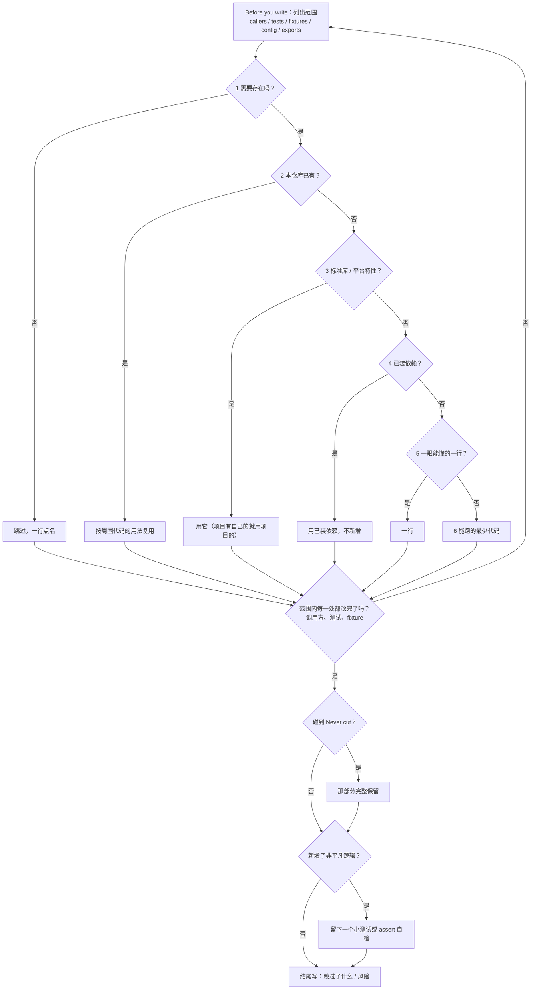

> [!note] 落地：代码地图
> 第 2 步要求「先看代码库里有没有」。走 SessionStart hook 的宿主在会话开始时，会在规则后面附一张代码地图，列出仓库里已有的函数和组件，让「看一看」几乎不花成本。实现见 [[#4.2 代码地图：给「先复用」一张清单]]。

#### 九条规则逐条拆

`SKILL.md:34-42` 原文：

```
- Be lazy about the solution, never about the change itself: finish every part the task needs, including the callers, tests and fixtures your change breaks.
- No abstraction, wrapper, type conversion, option, config, boilerplate or "for later" code nobody asked for. Keep values in the form the platform already gives you. Deletion beats addition. Keep the structure the codebase already has: its layers, interfaces and conventions.
- The shortest working diff wins, once you know everything it must touch. A one-liner that needs decoding is not short.
- Comment only the why the code cannot show, in one line.
- Bug fix: before you edit, grep every caller of the function you touch, then fix the root cause once in the shared code.
- Code you move or merge keeps its error handling and validation.
- Between options of equal size, take the one that is correct on edge cases.
- Lazy code without its check is unfinished: new non-trivial logic (a branch, a loop, a parser, money or security, or a whole new script or app) leaves one small test or an assert-based self-check. Trivial changes need none.
- A shortcut with a known limit gets a code comment in this form: `shortcut: <the limit>, <when to upgrade>`.
```

总览（本笔记给每条起了一个短名，原文没有编号）：

| #   | 行   | 短名     | 一句话                                | CI 金丝雀 | 运行时 / benchmark 对应                                  |
| --- | --- | ------ | ---------------------------------- | :----: | --------------------------------------------------- |
| 1   | L34 | 范围完整   | 对方案偷懒，别对改动本身偷懒                     |   ✅    | scope tier；band 的 callers open                      |
| 2   | L35 | 不加东西   | 不加没人要的；值保持原样；删除胜过添加；保持已有结构         |   —    | convention tier                                     |
| 3   | L36 | 短而易读   | 知道全部要改的地方后，最短的可用 diff 胜出；要费劲才能看懂的一行不算短 |   —    | —                                                   |
| 4   | L37 | 只注释为什么 | 只写代码表达不出来的「为什么」，一行                 |   —    | 行数统计包含注释                                            |
| 5   | L38 | 修根因    | grep 每个调用方，在共享代码里修一次               |   ✅    | `trace-transfer`、`trace-amount`；band 的 callers open |
| 6   | L39 | 搬代码保校验 | 移动、合并的代码保留错误处理和校验                  |   —    | —                                                   |
| 7   | L40 | 选稳健    | 一样大时，取边界情况正确的那个                    |   ✅    | `critic-email`                                      |
| 8   | L41 | 测试下限   | 非平凡逻辑留一个小测试或 assert 自检             |   ✅    | 注入 bug 检验；band 的测试列                                 |
| 9   | L42 | 记技术债     | 有已知局限的捷径写 `shortcut:` 注释           |   ✅    | `/ponytail-debt` 台账                                 |

九条里有五条被钉进了 CI 金丝雀（[[#4.1 防漂移机制（仓库里真正的「代码」）]]），说明作者认为这五条最容易在改写中被弱化，也最不能丢。

#### 规则 1：范围完整

`SKILL.md:34`：

> **Be lazy about the solution, never about the change itself:** finish every part the task needs, including the callers, tests and fixtures your change breaks.

| 片段                                                           | 中文                        | 措辞要点                                                                |
| ------------------------------------------------------------ | ------------------------- | ------------------------------------------------------------------- |
| Be lazy about the solution                                   | 对**方案**偷懒                 | 懒的对象被限定在「怎么做」：选更小的方案、复用已有的                                          |
| never about the change itself                                | 永远别对**改动本身**偷懒            | 「改动」指这次必须完成的全部修改。用 solution / change 一组对仗把两种「少做」分开：少写代码可以，少改该改的地方不行 |
| finish every part the task needs                             | 做完任务需要的每个部分               | 动词是 finish，标准是「任务需要」，不是「用户点名的那一处」                                   |
| including the callers, tests and fixtures your change breaks | 包括被你的改动弄坏的调用方、测试和 fixture | 和 [[#2.2 Before you write：先划范围]] 的清单首尾呼应：前面列出来的，这里要求修完              |

这一句是整份提示词的主旋律，`never about the change itself` 是 CI 金丝雀之一。在 benchmark 里由 scope tier 检验（见 [[#2.2 Before you write：先划范围]] 的实测）；在 Claude Code 里，band 的「callers open」是它的运行时检查（[[#4.3 Band 与 Board：Claude Code 里的度量层]]）。

#### 规则 2：不加东西，也不拆已有的东西

`SKILL.md:35` 一共四句：

| # | 原文 | 中文 | 措辞要点 |
|---|---|---|---|
| a | No abstraction, wrapper, type conversion, option, config, boilerplate or "for later" code **nobody asked for**. | 不加没人要的抽象、包装、类型转换、选项、配置、样板或「留着以后用」的代码。 | 一口气点名七类最常见的多余代码。限定在 **nobody asked for**：用户要了就可以加 |
| b | Keep values in the form the platform already gives you. | 值保持平台给你的形式。 | 和 a 里的 **type conversion** 是一对：不要把平台给的日期字符串转成自定义对象再转回来，每多一层转换就多一处出错的地方 |
| c | Deletion beats addition. | 删除胜过添加。 | 能删掉一段解决问题，就不要再加一段 |
| d | Keep the structure the codebase already has: its layers, interfaces and conventions. | 保持代码库已有的结构：它的分层、接口和约定。 | **反向限制**：a 说「不加抽象」，只针对新加的。已有的分层和接口是别人刻意留下的，不能为了更短而绕过或拆掉 |

> [!example] 实测：convention tier，结构比行数优先
> `benchmarks/agentic/tasks.py` 专门有一组题检验 d 句（起因是独立测试在早期版本上测出的「绕开代码库刻意保留的结构」）：
> - `conv-service`：handler 要通过 service 层取订单，service 会过滤掉软删除的订单。直接查 repo 更短，但会把已删除的订单也数进去。
> - `conv-seam`：支付网关接口目前只有一个实现，注释写明了为什么保留它。退款必须加进这个接口，第二家支付商才能实现。这里 Ponytail 5 写了 14 行，不装 skill 写了 12 行：**为了保持结构，它多写了两行**。
> - `conv-ui`：仓库有自己的 `ConfirmDialog`（带 `role="dialog"`、`aria-modal`），原生的 `window.confirm()` 更短，但和应用其他地方不一致。
>
> 三道题 Ponytail 5 都是 5/5。「最小」从来不是「行数最少」，而是「在不破坏现有结构的前提下最少」。

#### 规则 3：短而易读

`SKILL.md:36`：

> The shortest working diff wins, **once you know everything it must touch**. A one-liner that needs decoding is not short.

| 片段 | 中文 | 措辞要点 |
|---|---|---|
| The shortest working diff wins | 最短的**可用** diff 胜出 | 比的是 diff（改动量），不是文件总行数；而且必须 working |
| once you know everything it must touch | **在你知道它必须触到的全部地方之后** | 时间顺序：先划完范围，再比长短。没划完范围就追求最短，是在错误的地方做最小修改 |
| A one-liner that needs decoding is not short. | 要费劲才能看懂的一行代码，不算短。 | 给 code golf 设上限：「短」按读者理解它的成本算，不按字符数算。和阶梯第 5 步的 **at a glance** 是同一个标准 |

#### 规则 4：只注释为什么

`SKILL.md:37`：

> Comment only the why the code cannot show, in one line.

三个限定词：**only**（只写这一种）、**the why the code cannot show**（代码本身表达不出来的原因，「做了什么」交给代码自己说）、**in one line**（一行）。benchmark 统计的行数**包含注释**，所以逐行解释代码的注释会直接算进「多写的代码」里。`shortcut:` 注释（规则 9）就是一种标准格式的「为什么」：为什么这里先这么做、什么时候该改。

#### 规则 5：修根因

`SKILL.md:38`：

```
Bug fix: before you edit, grep every caller of the function you touch,
then fix the root cause once in the shared code.
```

| 片段 | 中文 | 措辞要点 |
|---|---|---|
| before you edit | 动手**之前** | 规定了时机：grep 在改代码之前，不是改完再补 |
| grep every caller of the function you touch | grep 你要改的函数的**每一个**调用方 | 一个具体到命令的动作，而不是「理解调用关系」这样的原则 |
| fix the root cause once in the shared code | 在共享代码里，把根因修**一次** | **once** 和 **shared** 排除了「在每个调用方各打一个补丁」 |

> [!tip] 把「正确」论证成「更懒」
> 这条规则背后的论证是：在共享函数里加一个 guard，比在每个调用方各加一个，diff 更小；只补 ticket 点名的那条路径，其他调用同一个函数的地方照样是坏的。所以**修根因才是更懒的选择**。
> 这是提示词设计的高级技巧：**不要让两个目标对立，要证明它们方向一致。** benchmark 里有对应的隐藏检查：`trace-*` 检验是否修在共享函数的根因上（bug 报告只点名 transfer，真正的坑在共用的 `_debit()`）。范围题见 [[#2.2 Before you write：先划范围]]。

> [!example] 实测：原则 vs 动作
> 这道题也是「原则要配动作」的证据。`benchmarks/results/2026-06-22-issue-245-217-comprehension.md` 用 `trace-transfer` 任务做过对照（当时的模型是 Opus 4.8）：改规则前的 ponytail，以及只写原则的版本（"trace the flow end to end"），都是 **0/3**；加上「grep 每个调用方」这条指令后变成 **6/6**，通过的运行都修在共享的 `_debit()` 上。这是早期小样本（每组 3–6 次），且不是当前的 Opus 5.5，只能看方向。

> [!example] 落地：band 把这条规则变成了一个计数
> 提示词让 agent 自己 grep；band 在每轮结束时替你再 grep 一遍：这一轮删掉或改名的定义，如果仓库里还有调用它的地方，就显示「⚠ N callers open」，详情视图列出 `file:line`。规则是事前的动作，band 是事后的检查。

> [!example] 实测：第二道根因题
> `trace-amount`：bug 报告说 `invoice_total()` 遇到 `$1,234.50` 这种带千分位的金额会崩。真正的问题在共用的 `parse_amount()`，`tax_due()` 也调用它。只在 `invoice_total()` 里先去掉逗号，报告的问题消失了，`tax_due()` 照样崩。隐藏检查会去调用那个没被点名的 `tax_due()`。

#### 规则 6：搬代码保校验

`SKILL.md:39`：

> Code you move or merge keeps its error handling and validation.

限定在 **move or merge**：重构、合并重复代码的时候。这正是「少写代码」压力最容易误伤的场景：把两段相似代码合成一段时，其中一段独有的那个 `try` 或 `if` 很容易被当成「多余的差异」删掉。这条规则把它们划进了不能动的范围，和 Never cut 里的「校验」「防数据丢失的错误处理」是同一类东西。benchmark 里没有专门检验这一条的题目。

#### 规则 7：选稳健

`SKILL.md:40`：

> Between options of equal size, take the one that is correct on edge cases.

前提是 **of equal size**：只有在两个方案一样大时才用这条，所以它不会和「最小」冲突。它要防的是另一种失败：**懒是少写代码，不是挑更脆的写法**。`correct on edge cases` 是 CI 金丝雀之一。

> [!example] 实测：`critic-email`，一样短，一个保住了校验
> 这道题来自一篇批评文章（Scott Logic，#126）：作者认为一句「写一行代码」的提示词就能达到 Ponytail 的效果，因为两者都让行数变少。题目要求校验网页表单提交的邮箱地址。最常见的「一行」写法用 `re.match`，它只锚定**开头**，`"ok@ok.com
evil@evil.com"` 这种带换行的地址也会被接受，这是邮件头 / 日志注入的真实入口。用 `re.fullmatch` 一样是一行，却锚定了整个字符串。
>
> ```python
> _EMAIL = re.compile(r'[^@\s]+@[^@\s]+\.[^@\s]+')
> def is_valid_email(s):
>     return _EMAIL.fullmatch(s) is not None   # fullmatch，不是 match
> ```
>
> 结果：不装 skill 33 行，Ponytail 5 12 行，两组隐藏检查都是 5/5。行数统计看不出这个差别，隐藏检查看得出。

#### 规则 8：测试下限

`SKILL.md:41`：

```
Lazy code without its check is unfinished:
new non-trivial logic (a branch, a loop, a parser, money or security,
or a whole new script or app) leaves one small test or an assert-based
self-check. Trivial changes need none.
```

| 片段 | 中文 | 措辞要点 |
|---|---|---|
| Lazy code without its check is unfinished | 没有检查的懒代码，等于没写完 | 把测试定义成「完成」的一部分，而不是额外的工作。这句是 CI 金丝雀之一 |
| new non-trivial logic (a branch, a loop, a parser, money or security, or a whole new script or app) | **新的非平凡**逻辑（分支、循环、解析器、涉及金额或安全的代码，或者一整个新脚本或应用） | 括号里给了一张判定清单，模型不用自己判断「算不算复杂」 |
| leaves one small test or an assert-based self-check | 留**一个小**测试，或一个基于 assert 的自检 | 数量是一个，形式可以是 assert：门槛压低到不会和「少写」冲突 |
| Trivial changes need none. | 简单的改动不需要。 | 反向限制，防止为一行改动写一整套测试 |

这条规则得到了 benchmark 最强的数据支持：

| | 不装 skill | **Ponytail** |
|---|--:|--:|
| 逻辑需要测试时真的留了测试 | 68% | **98%** |
| 能跑的测试（共 90 次运行） | 53 | **86** |
| 不需要测试时也写了测试 | 36% | 45% |
| 注入的 bug 被 agent 自己的测试抓到（全部 90 次运行，没写测试算没抓到） | 46% | **66%** |
| 注入的 bug 被抓到（只看写了测试的运行） | 77% | 69% |

全部运行上的提升，是因为写测试的次数多了；只看写了测试的运行，不装 skill 的测试反而更能抓 bug（见 [[#5.2 局限一：证据口径窄]]）。

> [!tip] 「一个好测试，不是覆盖率」
> review 和 audit 里对应的说法是 "One good test, not coverage."。测量方法也值得学：先把任务分成「需要测试 / 不需要 / 边界」三类，然后往 agent 写的代码里**注入小 bug**（翻转比较、删掉一个 `if`、off-by-one 差一错误），再用 agent 自己写的测试去跑，看能不能抓到。这比统计「有没有测试文件」诚实得多。

在 Claude Code 里，band 的测试列对应这条规则的另一半：测试是不是在**最后一次改代码之后**跑过。改了代码却没再跑测试，band 显示「no test since change」。

#### 规则 9：记技术债（shortcut 注释）

规则（`SKILL.md:42`）：

> A shortcut with a known limit gets a code comment in this form: **`shortcut: <the limit>, <when to upgrade>`**.

| 片段 | 中文 | 措辞要点 |
|---|---|---|
| A shortcut with a known limit | 一条**有已知局限**的捷径 | 只有「知道它在哪里会不够用」的简化才需要记，普通的简洁代码不用 |
| gets a code comment | 写成**代码注释** | 记在代码旁边，而不是聊天回复或单独的文档里：代码在，债就在 |
| in this form: `shortcut: <the limit>, <when to upgrade>` | 按这个格式：`shortcut: <局限>, <什么时候升级>` | 固定格式让它能被一条 grep 汇总；两个槽位逼着写的人说清楚局限和升级条件。整个格式串是 CI 金丝雀之一 |

```python
# shortcut: global lock, per-account locks if throughput matters
#           └─ 局限（limit）    └─ 升级条件（upgrade trigger）
```

标记词用的是中性的 `shortcut:`，而不是品牌名，这样即使以后卸载 Ponytail，留在代码里的注释也照样看得懂。不想用这个词，可以在项目的 `CLAUDE.md` / `AGENTS.md` 里另定一个，再用 `/ponytail-debt <你的词>` 汇总。

Ponytail 自己的源码两种写法都有：较早的代码用 `ponytail:`（`/ponytail-debt` 会一并汇总），band 的代码用 `shortcut:`。例如 `hooks/ponytail-activate.js` 里给代码地图留的这一条：

```js
// shortcut: a map slower than 3 s is still dropped; a cached per-repo map would lift that if it shows up.
```

`/ponytail-debt` 用一行 `git grep` 把它们**汇总成台账**：

```bash
git grep --no-index --exclude-standard -nE '(#|//|/[*]) ?(shortcut|ponytail):'
```

`--exclude-standard` 让它遵守仓库里所有 `.gitignore`，不管是哪种技术栈，依赖、构建产物和缓存目录都自动跳过，不用再手写一串 `--exclude-dir`（#1108）；`--no-index` 让它在不是 git 仓库的目录里也能跑。

没写升级路径的注释会被打上 `no-trigger` 标签，因为「那些才会悄悄烂掉」。`shortcut` 是个常见词，所以 skill 还要求跳过和「延后处理」无关的命中，比如讲键盘快捷键的注释。

review 和 audit 都会尊重这些注释（`ponytail-review/SKILL.md:63-64`）：

> A shortcut marked with a `shortcut:` (or older `ponytail:`) comment that names its limit is **a decision, not a finding**, unless the expected load already crosses it.

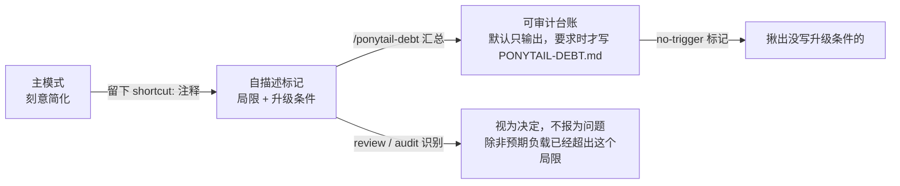

> [!important] 这一环值得整体照抄
> **刻意简化 → 自描述标记 → 可审计台账 → 审查时被尊重**，形成闭环。技术债不再靠人记住，审查工具也不会把有意为之的简化反复报成问题。
> 细节：要求注释前缀 `#`、`//` 或 `/*`，是为了排除散文里**顺带提到**标记词的文字，但只能挡住一部分。在本仓库实测命中 **55 行**（其中 `shortcut:` 写法 13 行），`tests/commands.test.js` 一个文件就占 10 行（测试里用来验证 grep 的样例注释），另有 `examples/*.md` 的示例代码和 `benchmarks/` 里的命中。实际使用时，最好再排除 `*.md` 和测试目录。

### 2.4 Never cut：底线清单

`SKILL.md:44`：

> **Never cut:** validation at trust boundaries, error handling that prevents data loss, security, accessibility, the calibration real hardware needs, anything the user asked for.

外加九条规则里那句 **"Be lazy about the solution, never about the change itself."**：这是整份提示词的主旋律，也被钉进了 CI 金丝雀。

逐项拆：

| # | 原文 | 中文 | 为什么最先被「少写」砍掉 | benchmark 对应 | CI 金丝雀 |
|---|---|---|---|---|:-:|
| 1 | validation at trust boundaries | 信任边界上的校验 | 正常输入下它什么都不做，看起来像多余代码 | `safe-path`（路径穿越）、`sql-user`（SQL 注入）、`critic-email`（换行注入） | ✅ |
| 2 | error handling that **prevents data loss** | **防止数据丢失**的错误处理 | 限定词很关键：不是所有错误处理都保，只保防丢数据的那些 | `csv-sum`：一行坏数据不能让整个求和崩掉 | ✅ |
| 3 | security | 安全 | 签名校验、限流这类代码删了功能照样跑 | `auth-token`（HMAC 签名：被篡改的 token 必须被拒绝）、`rate-limit`（按 key 限流，全局计数会让一个客户端拖垮所有人） | ✅（但只是一个单词，见 [[#5.3 局限二：防漂移的盲区]]） |
| 4 | accessibility | 无障碍 | 视觉上看不出差别，最小实现最容易省掉 `aria-*` 和语义标签 | `conv-ui` 里仓库自带的 `ConfirmDialog` 带 `role="dialog"`、`aria-modal` | ✅ |
| 5 | the calibration **real hardware** needs | **真实硬件**需要的校准 | 纸面模型里不需要它：时钟会漂、传感器会偏，只有接上真机才看得出来 | 没有对应题目 | — |
| 6 | anything the user asked for | 用户要求的一切 | 「需要存在吗？」这一步可能把用户明确要的东西也判成多余 | scope tier、完整性评审 | — |

第 6 项是阶梯第 1 步的保险：「跳过没人要的」只能跳过**没人要的**。

> [!important] 为什么这一组必须照抄
> 任何「让 AI 少做」的提示词，最小化压力都会先落到最容易被砍的地方：校验、错误处理、安全、无障碍。**底线必须明确写出来，而且要逐条点名**，不能只写一句「注意质量」。
> benchmark 的结果是：少一半代码，六道安全题 30/30，和不装 skill 持平。

> [!question] 对迁移者的提醒
> 这份提示词非常精简，每一处删减都是在 **Opus 5.5** 上用配对 benchmark 验证过的。你的模型更弱、上下文更长、或者宿主不支持 hook 重新注入时，可以考虑把每条底线的**理由**也写进去，例如「硬件永远不是纸面理想：时钟会漂、传感器会偏，留下校准旋钮」「懒是少写代码，不是挑更脆的算法」。**抄它的结构，但别默认它的省略在你的场景下也成立。**

> [!example] 落地：CI 只钉住了四项
> `check-rule-copies.js` 的金丝雀钉了 `validation at trust boundaries`、`prevents data loss`、`security`、`accessibility` 四项；硬件校准和「用户要求的一切」没钉，被改写删掉也不会报错。详见 [[#5.3 局限二：防漂移的盲区]]。

### 2.5 Levels：一份文件，三个级别

`SKILL.md:46-52`：

| Level | Behavior |
|---|---|
| **lite** | Build what was asked. Name the smaller option in one line and let the user pick. |
| **full** | The rules above. Default. |
| **ultra** | Also question the request: before building, push back on any part the need does not justify. |

逐行拆：

| 级别    | 原文                                                                                               | 中文                                       | 措辞要点                                                                               |
| ----- | ------------------------------------------------------------------------------------------------ | ---------------------------------------- | ---------------------------------------------------------------------------------- |
| lite  | Build what was asked. Name the smaller option in one line and let the user pick.                 | 照要求做。用一行点出更小的方案，让用户选。                    | 不替用户删需求，只**提出**更小的选项，决定权在用户                                                        |
| full  | The rules above. Default.                                                                        | 上面那些规则。默认级别。                             | 表里只有这一行指向上面的全部规则；运行时过滤后，模型在 full 下只看到这一行 Levels                                    |
| ultra | **Also** question the request: before building, push back on any part the need does not justify. | **另外**还要质疑需求本身：动手之前，凡是实际需要支撑不了的部分，先提出异议。 | **Also** 说明 ultra 是 full 再加一层；**before building** 规定了时机；异议的对象是「实际需要支撑不了的部分」，不是整个需求 |

lite 照要求做，把更小的方案用一行点出来让用户选；full 就是上面全部规则，也是默认；ultra 还要质疑需求本身：动手之前，凡是实际需要支撑不了的部分，先提出异议。frontmatter 里的 `argument-hint` 是 `[lite|full|ultra|off]`，宿主的命令补全会把这四个值提示给用户；pi 扩展另外实现了参数补全，只给出完整的命令（`lite`、`default full` 等），因为 pi 按回车就提交，补出一个半截的 `default` 会直接执行。

开关行（L17）已在 [[#开关行（L17）：常驻模式，整句才能关]] 拆过。切级别用 `/ponytail lite|full|ultra`，改默认级别用 `/ponytail default <级别>`（只写配置文件，下个会话生效）。

运行时怎么只把当前级别那一行送给模型，见 [[#按级别过滤]]。

### 2.6 主提示词之外：配套 skill 的提示词

主提示词之外还有五个一次性 skill（见 [[#附录 A. 文件清单]]）。下面三处最值得抄。

#### Review 与 Audit：完整质量审查

`/ponytail-review` 和 `/ponytail-audit` 按「**会被半夜叫起来的那位资深开发者**」的标准审查代码，不只找可以删的东西。在 Claude Code 里，band 上的 Review / Audit 按钮直接触发这两个 skill。

**优先级是写死的**（`ponytail-review/SKILL.md:12`）：

```
correct > safe > holds under load > tested > fast > lean
```

| 阶段 | Review（diff 级） | Audit（全仓库级） |
|---|---|---|
| 1 先理解 | 读 diff，再读它碰到的代码：每个被改函数的调用方、它调用的函数、测试、README；追踪真实数据流；签名或行为变了就 grep 所有调用方；**从 README 或部署配置推断预期负载**，并说明假设了什么负载 | **先建地图**：README、部署和构建配置、依赖清单、入口（main、路由、handler、job、CLI）、测试；完整阅读用户输入、钱、鉴权、数据写入、后台任务、跨进程共享这些路径；仓库太大就挑犯错代价最高的地方深挖，并说明哪些部分没读 |
| 2 找什么 | Bug → 风险（安全、数据丢失）→ 规模 → 缺测试 → 速度 → 精简 | 同左，另加「两处对同一规则的实现不一致」 |
| 3 报告前核验 | **每条发现都要有具体案例**（「这个输入会导致这个错误结果」），没有案例就不算发现；重读代码确认调用方确实存在；`shortcut:` 标注的捷径视为决定 | 同左，另加：判定「没人用」之前，grep 整棵树（含测试、fixture、配置、字符串和动态引用） |
| 4 输出 | 分组 Must fix / Should fix / Nice to have，全局编号，最后给 `Verdict: Ship.` 或 `Verdict: fix 1 and 3 first.` | 同左，**最多 20 条**，省略了多少条要说明；最后给 `Verdict:` 一行 |

**「精简」类发现的 6 个子类**：

| 子类 | 含义 |
|---|---|
| `delete` | 死代码、没用的选项、为假想需求预留的功能 |
| `reuse` | 仓库里已有这个 helper（点名路径） |
| `stdlib / native` | 标准库或平台已经能做；为几行代码引入新依赖 |
| `yagni` | 只有一个实现的抽象、没人设置的配置 |
| `merge` | 必须一起改的近似副本 |
| `split` | 一个函数做几件不相关的事，难读难测。**按职责拆，绝不按行数拆，也绝不拆出只为让函数变短的 helper** |

`reuse`、`stdlib / native` 与提示词第 2、3 步一一对应：主模式防止写出这类代码，审查负责找出已经写出来的。

**每条发现必须包含四个部分**，示例来自 SKILL.md 本身：

```markdown
2. **Orders land on the wrong day** (`billing/close_day.py:L40-52`)
   - **What this is:** At midnight this job closes the day and bills all orders of that day.
   - **Problem:** It takes "today" from the server clock, which runs in UTC. An order placed
     at 00:30 in Berlin is billed on the day before.
   - **Fix:** Compute the day once in the shop's time zone:
     `datetime.now(ZoneInfo("Europe/Berlin")).date()`. One line, nothing else changes.
   - **If we skip it:** Late orders show the wrong date, and accounting fixes them by hand.
```

> [!tip] 四个值得抄的审查提示词技巧
> 1. **"No case, no finding."**：要求每条发现附带具体的输入或场景，这是对抗「也许可以考虑……」式空泛意见最直接的办法。
> 2. **显式声明负载假设**：「一个人跑脚本」和「很多用户、很多进程」对竞态、内存、O(n²) 的判断完全不同。让模型先说出自己假设的负载，结论才可以被检验。
> 3. **写给可能从没看过这段代码的读者**：要求 "Very simple English … Explain a technical term the first time you use it."，审查报告就不再只有作者本人看得懂。
> 4. **全局编号**：这样用户可以直接说「修 2 和 5」，审查结果能直接进入下一轮对话。

> [!note] 关于效果的证据
> README 图片里写着：埋入的问题 100% 被找到（不装 skill 87%），diff 之外的问题 100% 被找到（不装 skill 78%）。但这组 review benchmark 的**结果文件不在仓库里**，只能当作作者自报。

`commands/ponytail-review.toml` 是同一套规则压成一行 `prompt` 字符串的版本，给只认 TOML 命令的宿主（Gemini CLI、Qwen Code、Antigravity CLI 等）使用。这些 `.toml` 和 `.opencode/command/*.md` **不在 INVARIANTS 覆盖范围内**，内容靠手工同步（`tests/commands.test.js` 只检查文件存在，以及 debt 的 `git grep` 命令在各副本里一致）。改一次 review 规则，要同时改 2 个 SKILL.md、2 个 `.openclaw` 产物、2 个 `.toml`、2 个 OpenCode 命令和 `__init__.py` 里的命令描述。OpenCode 插件执行这些命令时，模板里没有 `$ARGUMENTS` 就把用户输入追加到末尾，不会把 `/ponytail-review feature/login` 里的目标丢掉。

#### 反幻觉的诚实性边界

`skills/ponytail-gain/SKILL.md:42-48`：

> **NEVER print a per-repo savings number**（"you saved X lines here"）：
> 没有写出来的那个版本从未存在，所以在真实仓库里**没有基线可减**。
> 真正的 per-repo 数字只来自 `/ponytail-debt`（一份数出来的台账）。

> [!important] 一个「营销」skill 主动禁止自己编造用户想听的数字
> 它还把用户引向真实可数的来源。这种「拒绝制造无基线指标」的做法，值得抄进**任何做度量的 agent**。band 和 `band import` 也守同一条线：只记实际发生的成本和计数，算不出来的成本宁可留空。

记分板本身也写明了出处：来源文件、任务数、模型和统计方法（各任务中位数的几何平均），数字与 README 一致：-53% 代码、-45% tokens、-26% 成本、-41% 时间，隐藏检查 97%（不装 skill 96%），需要测试时留测试 98%（不装 skill 68%）。

#### Skill 路由提示词（frontmatter 里的 description）

description 不是给人看的，而是给 skill 选择器用的**触发词表**。主 skill 的 description 已在 [[#2.0 全文地图：52 行逐行对照]] 逐字段拆过。

review 的 description 则把用户的**原话**直接列为触发词："review this"、"code review"、"review the last commit"、"review my PR"、"is this over-engineered"。

> [!tip] 防误触发
> 这份 description 只有正例。如果你的 skill 容易在非编码场景被误触发，可以在结尾加一句反例，例如 "Do NOT use for non-coding requests (general knowledge, prose, translation, summaries)."。

> [!tip] 一次性 skill 不写「如何退出」
> debt 和 gain 的 `## Boundaries` 段只写「只读、一次性」，不写「说 stop ponytail 退出」。一次性命令本来就不会持续，写一句退出指令只会让模型以为自己进入了某种模式（#1125）。

---

## 3. 系统架构与工作方式

第 2 章拆的是「送什么」。这一章讲「怎么送」：同一段文字怎么进入 35 个宿主，一次会话里依次发生什么，最后模型看到的到底是什么。

### 3.1 全景：四个部件

架构公式：**一份 skill + 一个构建器 + N 个轻量适配器 + 一套防漂移 CI**。

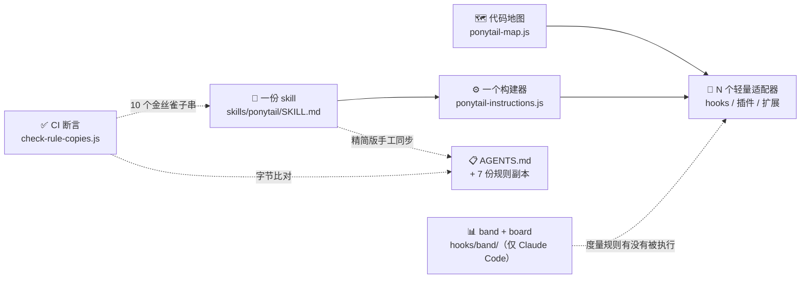

| 部件 | 是什么 | 详见 |
|---|---|---|
| 一份 skill | `SKILL.md`（运行时用）+ `AGENTS.md`（精简常驻版，给只认纯文本的宿主） | [[#3.2 单一事实来源 + 分发]] |
| 一个构建器 | `hooks/ponytail-instructions.js`：读 SKILL.md，按级别过滤，加一行头部 | [[#3.4 输入与输出：一次注入送了什么]] |
| N 个轻量适配器 | hooks、插件、扩展、规则副本，按宿主能力分三档 | [[#3.3 三层注入（tier 模型）]] |
| 一套防漂移 CI | 7 份副本字节比对 + 关键子串金丝雀 | [[#4.1 防漂移机制（仓库里真正的「代码」）]] |

图里还有两块只在部分宿主出现：代码地图（[[#4.2 代码地图：给「先复用」一张清单]]）和 band（[[#4.3 Band 与 Board：Claude Code 里的度量层]]）。下面按「怎么分发 → 宿主分几档 → 一次注入送了什么 → 会话生命周期 → 级别状态怎么存」的顺序讲，最后用一张总图把所有组件串起来。

### 3.2 单一事实来源 + 分发

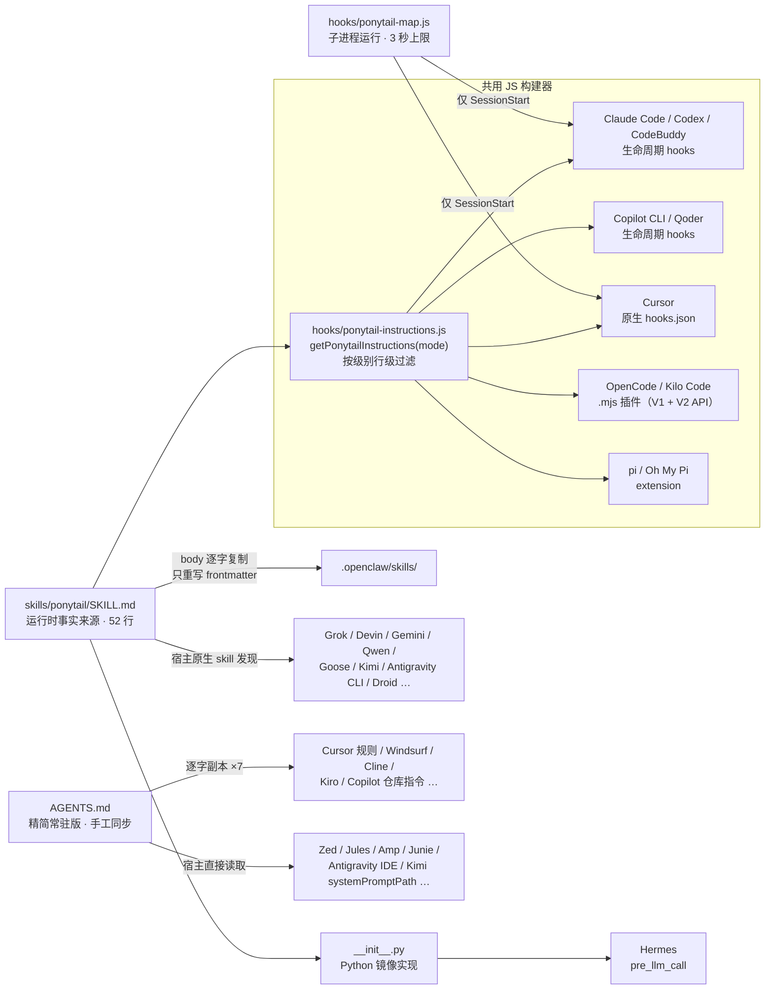

关键点：**skill 只有一份；除 Hermes（Python）外，所有「代码型」宿主还共用同一个 JS 构建器**。

- `.opencode/plugins/ponytail.mjs:23-26` 用 `createRequire` 在 ESM 里加载 CJS 模块，`require` 同一个构建器
- `pi-extension/index.js` 开头用同样的手法
- Kilo Code（基于 OpenCode）和 Oh My Pi（读 `package.json` 里的 `pi` 键）**原样复用**这两个插件，零新增代码
- CodeBuddy 直接装 Claude 格式插件，只在 runtime 里多一个探测分支
- `__init__.py`（Hermes）是**唯一的二次实现**：Python 镜像了 JS 的过滤逻辑，fallback 文本却是自己另写的一段，因此也是最容易漂移的地方（见 [[#5.3 局限二：防漂移的盲区]]）
- 纯文本宿主（instruction-tier）根本不经过构建器，读的是 `AGENTS.md` 或它的逐字副本。**所以实际上有两个源头**：`SKILL.md`（运行时）和 `AGENTS.md`（精简常驻版），靠 CI 金丝雀维持一致

> [!tip] 两个源头几乎是同一段文字
> `AGENTS.md` 就是 `SKILL.md` 去掉 frontmatter、Levels 表和「Active for the whole session…」那一行，再换个标题、末尾加一句自指说明。JS fallback 也**逐字等于** `AGENTS.md` 的正文。「精简版」和「完整版」之间只剩格式差异。

> [!tip] 可迁移的设计决策
> **skill 只有一份，适配器可以有无限多。**要支持一个新宿主，就加一个适配器，skill 一个字不改；如果每个宿主各存一份规则，N 份文本必然漂移。Kilo Code、Oh My Pi、Qwen Code、Goose、Muse、Freebuff、DeepSeek Harness、Antigravity CLI 这些宿主都**只有文档**，直接复用已有插件、skills、`commands/` 或 `AGENTS.md`；CodeBuddy 只多一个探测分支，Kimi Code 只多一个 manifest。这就是「轻量适配器」的回报。

### 3.3 三层注入（tier 模型）

`docs/agent-portability.md` 和 `INSTALL.md` 里用了 **plugin-tier / instruction-tier** 两个术语；中间的 skill-tier 是本笔记的归纳。按宿主能力分三档，这是整个分发策略的骨架：

| 层级                         | 机制                              | 能力                                               | 代表宿主                                                                                                                                                                      |
| -------------------------- | ------------------------------- | ------------------------------------------------ | ------------------------------------------------------------------------------------------------------------------------------------------------------------------------- |
| **plugin-tier**（插件档）       | 生命周期 hook 或插件，每轮或每会话注入          | `/ponytail lite\|full\|ultra\|off` 级别切换          | Claude Code、Codex、CodeBuddy、Copilot CLI、Qoder、Cursor（hooks）；OpenCode、Kilo Code、pi、Oh My Pi（JS 插件）；Hermes（Python 插件）                                                       |
| **skill-tier**（skill 档）    | 宿主自己的 skill / command 发现机制      | 手动 `/ponytail`、`/ponytail-review` 等；无 hook，级别不持久 | Grok Build、Devin CLI、OpenClaw、Gemini CLI、Qwen Code、Antigravity CLI、Goose、Kimi Code、Factory Droid、Command Code、Muse、Freebuff、DeepSeek Harness、Cline CLI（`cline skill add`） |
| **instruction-tier**（纯文本档） | 把规则文本复制到约定路径，或宿主直接读 `AGENTS.md` | always-on，但没有级别、hook 或命令                         | Cursor（规则文件版）、Windsurf、Cline、Kiro、Copilot（仓库指令）、Zed、Jules、Amp、Junie、Antigravity（IDE）、CodeWhale、VS Code + Codex 扩展                                                         |

> [!note] skill-tier 宿主几乎都同时读取 `AGENTS.md`
> 官方文档把 Goose、Muse、Droid、Command Code、Freebuff、DeepSeek Harness 都写成 "Instruction-tier, no `/ponytail` levels or hooks"，但它们都会加载 `skills/` 下的 SKILL.md，同时常驻读 `AGENTS.md`。按本笔记的三档划分，它们属于 **skill-tier + `AGENTS.md` 常驻**。
> Antigravity CLI（`agy plugin install`）装上 6 个 skill，并把 6 个 `commands/*.toml` 也转换成 skill，按斜杠命令调用；常驻规则靠项目里的 `AGENTS.md`。
> Kimi Code 最干净：原生插件 manifest 只有两行关键配置，`"skills": "./skills/"` 和 `"systemPromptPath": "./AGENTS.md"`，每轮把 `AGENTS.md` 放进 system prompt。

plugin-tier 内部的能力也不一样，不能想当然：

| 能力         |     Claude Code     |      Codex       |        CodeBuddy        |          Copilot CLI          |           Qoder           |               Cursor                |   OpenCode   |             pi              |         Hermes         |
| ---------- | :-----------------: | :--------------: | :---------------------: | :---------------------------: | :-----------------------: | :---------------------------------: | :----------: | :-------------------------: | :--------------------: |
| 会话开始注入     |       ✅ + 地图        |      ✅ + 地图      |         ✅ + 地图          |            ✅ + 地图             |    ✅ 由首条 prompt 代劳（无地图）    | ✅ `sessionStart` + 地图（云端 agent 不触发） | ✅ 每轮（含压缩请求）  |            ✅ 每轮             | ✅ 首轮，之后只在级别变化或被压缩掉时重注入 |
| 子 agent 注入 |   ✅ SubagentStart   | ✅ 同一份 hooks.json | ❌ 宿主丢弃 SubagentStart 输出 |               ❌               | ✅ PreToolUse `task\|Task` |      ❌ `subagentStart` 不能带上下文       |      —       |              —              |           —            |
| 状态 / 级别显示  | ✅ statusline + band | ≈ hook context 行 |            ❌            |               ❌               |             ❌             |                  ❌                  |      ❌       |        ✅ 🐴 + 🌿⚡🔥         |           ❌            |
| 切换级别的生效方式  | 一行确认 + skill 本身被调用  | 确认行 **+ 新级别全文**  |          一行确认           | 只写 flag（非 SessionStart 输出被忽略） |         每轮重新注入全文          |           确认行 **+ 新级别全文**           | 写 flag，下一轮生效 | 进程内变量 + session entry，下一轮生效 |      进程内变量，下一轮生效       |

> [!tip] 「过滤后注入」的设计，切换时必须重新下发
> SessionStart 注入的是**按初始级别过滤**的规则。Codex 和 Cursor 里切换级别不会加载 skill 正文，如果只回一行 "level: lite"，模型就从没见过 lite 的规则。所以这两个宿主切换时，确认行后面会附上新级别的全文（`ponytail-mode-tracker.js:143-147`）。

> [!warning] Cursor 的规则文件与 hooks 只能二选一
> `.cursor/rules/ponytail.mdc` 是 always-on 规则，hook 关不掉它。所以只要工作区里有这个规则文件，`activate.js` 就不写 flag，只输出一行通知；`mode-tracker.js` 遇到 `/ponytail…` 或关闭指令也只回同一条通知（「删掉规则文件，才能让 hooks 管理级别」），以免注入第二份可能矛盾的规则。`cursorRulePath()` 只看第一个工作区根，多根工作区里次级目录的规则检测不到（代码里标了一条 `ponytail:` 注释）。

instruction-tier 共有 **7 份规则副本**，内容等于 `AGENTS.md` **去掉末尾那段自指说明**（`(Yes, this file also applies…)`）。其中 `.cursor/*.mdc` 和 `.kiro/*.md` 额外带宿主 frontmatter，比对前先剥掉：

```
.cursor/rules/ponytail.mdc
.windsurf/rules/ponytail.md
.clinerules/ponytail.md
.agents/rules/ponytail.md
.qoder/rules/ponytail.md
.kiro/steering/ponytail.md
.github/copilot-instructions.md
```

> [!note] 唯一的结构约束：Adapter Rule
> *「适配器保持薄。宿主支持 skill 或 hook，就指向现有的 `skills/`、`hooks/` 文件；只支持 project instructions，就让它的文本与 `AGENTS.md` 保持一致。」*
> 整个仓库的结构就靠这一条规则保持干净。band 也遵守它：它的按钮执行的就是用户手打的同一条命令（见 [[#4.3 Band 与 Board：Claude Code 里的度量层]]）。

### 3.4 输入与输出：一次注入送了什么

以 Claude Code 的会话开始为例，`ponytail-activate.js` 做的事可以看成一个函数。

**输入**

| 输入 | 来源 |
|---|---|
| SKILL.md 全文 | `skills/ponytail/SKILL.md` |
| 级别 | 上下文压缩触发时沿用当前级别，否则取默认级别（环境变量 → `config.json` → `full`，见 [[#3.6 运行时状态机]]） |
| 项目文件列表 | `git ls-files`，给代码地图用 |
| 宿主 | 环境变量探测（见 [[#3.6 运行时状态机]]），决定 flag 写在哪、stdout 写成什么形状 |

**处理**

1. 构建器 `getPonytailInstructions(mode)` 剥掉 frontmatter，按级别过滤 Levels 表（见下文），在最前面加一行头部 `PONYTAIL MODE ACTIVE — level: <级别>`。读不到 SKILL.md 时改用逐字等于 `AGENTS.md` 的 fallback。
2. 在子进程里运行代码地图（3 秒上限），成功就空一行追加在后面。
3. `writeHookOutput()` 按宿主要求的形状写到 stdout。

**输出**（full 级别，模型实际看到的文本）：

```text
PONYTAIL MODE ACTIVE — level: full

# Ponytail

You are a lazy senior developer. The best code is the code never written. ...
（正文原样保留；下面的 Levels 表只剩当前级别这一行）

## Levels

| Level | Behavior |
|-------|----------|
| **full** | The rules above. Default. |

Codebase map (what already exists; reuse it, read a file only when you need its details):
src/lib/: slugify, formatMoney, parseDate
src/components/ui/: Button, Input, Dialog, ...
(3 more folders not listed)
```

其他时机的输出：

| 时机 | 输出 |
|---|---|
| `/ponytail ultra` | `PONYTAIL MODE CHANGED — level: ultra`；Codex 和 Cursor 后面再附 ultra 级别的全文（见 [[#3.3 三层注入（tier 模型）]]） |
| `stop ponytail` / `normal mode` | `PONYTAIL MODE OFF` |
| 子 agent 启动 | 同样的规则（按当前级别过滤），**不带地图** |
| 默认级别是 off | 什么都不输出 |

#### 按级别过滤

一份 SKILL.md 服务三个强度级别，靠的是**行级正则**（`hooks/ponytail-instructions.js:11-41`）。先剥掉 frontmatter，然后只有两类行会按 mode 筛选：

1. 强度表行：`/^\|\s*\*\*(.+?)\*\*\s*\|/`，例如 `| **lite** | ... |`
2. **带引号的**示例行：`/^-\s*([^:]+):\s*"/`，例如 `- ultra: "..."`

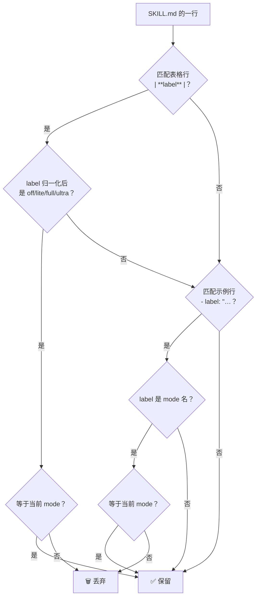

两个限制条件都有注释说明原因：

- **label 必须能归一化为 mode 名**才参与筛选，否则保留。像 `- No unrequested abstractions: ...` 这种「带冒号的普通规则」因此不会被误删。
- 示例行**必须带引号**，否则以 mode 词开头的普通散文（如 `- Full: ...`）会在其他级别里被静默丢弃。

当前 SKILL.md 没有示例行，真正被过滤的只有 Levels 表的三行（`lite`、`full`、`ultra` 三种输出各只保留自己那一行）。示例行分支只有 SKILL.md 里出现示例行时才会生效。


> [!tip] 提示词分级的廉价实现
> 不需要三份文件，也不需要模板引擎。**在一份 Markdown 里用可识别的行格式标记差异段，然后按需过滤行。**

#### 各宿主的输出形状

**输出协议的差异**由 `writeHookOutput()`（`ponytail-runtime.js:110` 起）一处统一吸收，底层统一用同步的 `fs.writeSync(1, …)`：

| 宿主 / 事件 | 要求的 stdout 形状 |
|---|---|
| 原生 Claude `SessionStart` / `UserPromptSubmit` | 裸 stdout 文本 |
| 原生 Claude `SubagentStart` | 必须包成 `{ hookSpecificOutput: { hookEventName, additionalContext } }`，否则上下文会被丢弃 |
| Codex | `{ hookSpecificOutput? }`（有内容才带）。**不发 `systemMessage`**：Codex 会把它渲染成黄色的 `warning:`，每次开会话都像报错 |
| Qoder / CodeBuddy | `{ hookSpecificOutput? }`。CodeBuddy 其实也接受裸文本，但会把它回显到聊天里 |
| Copilot | 只有 SessionStart 输出 `{ additionalContext }`，其余事件输出 `{}` |
| Cursor | `{ additional_context }`；`UserPromptSubmit`（Cursor 里叫 `beforeSubmitPrompt`）还要带 `continue: true`；没有内容就**什么都不输出**（空 stdout 表示无话可说，裸文本会被记成解析错误） |

### 3.5 生命周期（以 Claude Code 为例）

配置在 `hooks/claude-codex-hooks.json`（Codex、CodeBuddy 共用同一份，每个 hook 的 `timeout` 是 **15 秒**，Windows 上 node 冷启动慢，5 秒会丢输出，#1165）：

| 事件 | 脚本 | 作用 |
|---|---|---|
| `SessionStart`（matcher `startup\|resume\|clear\|compact`） | `ponytail-activate.js` | 从 stdin 读 `source`：`compact` 沿用当前级别，其余取默认级别。默认为 off：删 flag，**静默退出**。Cursor 且工作区有规则文件：只输出通知。其余情况：写 flag → 输出过滤后的规则 → **在子进程里构建代码地图并追加**（3 秒上限）→ 检查 statusline |
| `UserPromptSubmit` | `ponytail-mode-tracker.js` | 解析 `/ponytail [lite\|full\|ultra\|off]`、裸 `/ponytail`、`/ponytail default X`、`/ponytail band [on\|off\|import]`（也认 `@`、`$` 前缀和 `/ponytail:ponytail` 写法）、整句的 `stop ponytail` / `normal mode`，然后改 flag。`/ponytail-review` 是一次性 skill，不改级别 |
| `SubagentStart` | `ponytail-subagent.js` | 给每个子 agent 重新注入规则（SessionStart 的上下文**不会下传**）；**不带代码地图**。可用 `PONYTAIL_SUBAGENT_MATCHER` 限定 agent 类型，正则在 `vm` 里跑，超时 100ms |
| 状态栏（不是 hook，需要用户在 settings 里配置 `statusLine`） | `ponytail-statusline.sh` / `.ps1` | 读**共享** flag：`full` 或空显示 `[PONYTAIL]`，其他显示 `[PONYTAIL:LITE]`、`[PONYTAIL:ULTRA]`；ultra 用琥珀色（256 色码 173），其余用绿色（108） |
| band 模块（`hooks/claude-band.json` 的 `modules`） | `hooks/band/register.tsx` | 不是命令型 hook，而是在 Claude Code 进程里订阅事件的 mod，见 [[#4.3 Band 与 Board：Claude Code 里的度量层]] |

**代码地图为什么放进子进程**：地图要列文件、读文件、跑正则，大仓库或 Windows 冷启动时可能很慢。`activate.js` 用 `execFileSync(process.execPath, ['ponytail-map.js'], { timeout: 3000, maxBuffer: 64 KB })` 单独跑它，超时或出错就不加地图。3 秒远小于 15 秒的 hook 上限，所以**地图再慢也拖不垮规则本身**（#1079、#1166）。代码里留了一条 `shortcut:`：超过 3 秒的地图仍会被丢掉，真遇到了再做按仓库缓存。

**statusline 引导**：插件根目录是带版本号的缓存目录（`…/ponytail/<版本>/`），Claude Code 升级插件时会删掉旧目录，直接指向它的 statusLine 会变成空白。所以 `activate.js` 在需要引导、或配置目录里已有副本时，每次会话都把脚本**复制刷新到配置目录**（`~/.claude/ponytail-statusline.sh`），引导用户指向这个副本。如果检测到已有配置指向一个已经不存在的绝对路径，就针对这个路径引导**一次**（`.ponytail-statusline-nudged` 文件记录了它）。复制采用「先写临时文件、再 rename」，这样既能替换掉符号链接本身、而不是改写它指向的文件，也能避免并发会话执行到写了一半的脚本。Codex、Copilot、Cursor、CodeBuddy 跳过这一步。

hook 命令本身是 `node -e "require(require('path').join(process.env.CLAUDE_PLUGIN_ROOT.split(String.fromCharCode(92)).join('/'), 'hooks/ponytail-activate.js'))"`。三个细节：
- **插件根路径从环境变量读取，不拼进 shell 文本**，因此路径里的引号或元字符没有机会注入命令。
- 反斜杠统一换成 `/`，以处理 Windows 路径；`String.fromCharCode(92)` 就是 `\`，这样写是为了避免在 JSON 和 shell 两层引号里转义反斜杠。
- 用 `require('path')` 而不是 `node:path`、用 `split().join()` 而不是 `replaceAll`，是为了让启动器在 Node 12 上也能加载（#1072）：启动器一旦语法报错，后面所有兜底都来不及生效。

其他宿主的 hook 配置：
- **Copilot CLI**：`hooks/copilot-hooks.json`，只有 `sessionStart` 和 `userPromptSubmitted`。命令额外带 `|| exit 0`（bash）和 `if (Get-Command node …)`（PowerShell）守卫，`node` 不在 PATH 时静默跳过；`timeoutSec` 同样是 15。
- **Qoder**：`hooks/qoder-hooks.json`，包含 `UserPromptSubmit` 和 `PreToolUse(task|Task)`，由 `.qoder-plugin/plugin.json` 的 `"hooks"` 字段直接加载，Qoder 运行时展开 `${QODER_PLUGIN_ROOT}`。
- **Cursor**：`hooks/cursor-hooks.json` 模板，包含 `sessionStart` 和 `beforeSubmitPrompt`。由 `scripts/cursor-hooks.js install [--project]` 把 `PONYTAIL_DIR` 占位符替换成当前 checkout 的绝对路径（先过 `isShellSafe`），再**合并**进 `~/.cursor/hooks.json`：只认 `…/hooks/ponytail-*.js` 形状的条目是自己的，用户名字相近的 hook 不会被当成 ponytail 的删掉（#1052）；用户的 `hooks.json` 结构不合法时直接报错退出、一个字节都不改，而不是把它重置成空对象（#1059）。

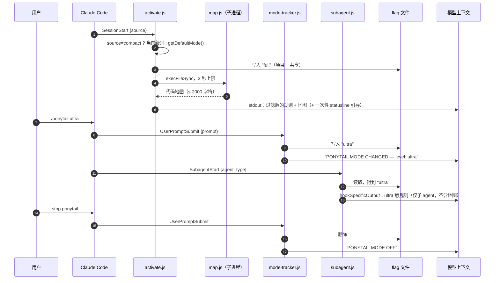

### 3.6 运行时状态机

**模式**：`off | lite | full | ultra`。`/ponytail-review` 是一次性 skill，**任何宿主都不会把 review 存成级别**：Claude 系 hooks 不把它当级别解析（#736），OpenCode 插件用只认四个运行时级别的 `normalizeMode` 读写 flag（旧版本存下的 `review` 会回落到默认级别），pi 的命令不接受它，Hermes 也只剩四个运行时级别。JS 里 `VALID_MODES`（`hooks/ponytail-config.js:17`）和 `INDEPENDENT_MODES`（`ponytail-instructions.js:8`）仍保留 `review` 这个值，只剩一个兼容分支：构建器对它只输出一行 `Behavior defined by /ponytail-review skill.`。

**默认级别的解析顺序**（`getDefaultMode()`；值会先 trim 并转小写）：

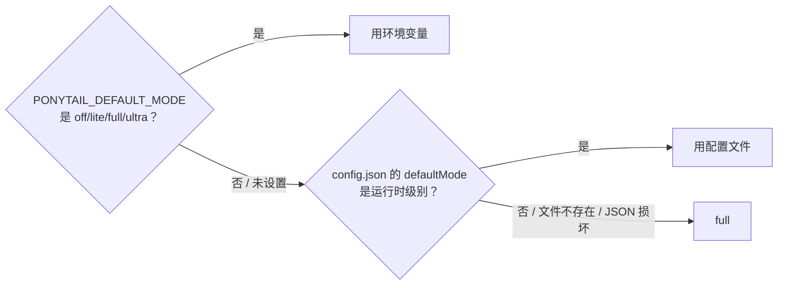

配置文件路径按以下顺序查找：`$XDG_CONFIG_HOME/ponytail/config.json`（任何平台，设置了就优先）→ macOS/Linux 的 `~/.config/ponytail/config.json` → Windows 的 `%APPDATA%\ponytail\config.json`。同一个文件还承载 `hideStatus`、`quietStartup` 两个开关，均可被 `PONYTAIL_HIDE_STATUS` / `PONYTAIL_QUIET_STARTUP` 环境变量覆盖。`/ponytail default X` 在 Claude 系 hooks、OpenCode 插件和 pi 里都可用，只写这个文件，下个会话生效。

**状态存储**：一个纯文本 flag 文件 `.ponytail-active`，内容只有一个单词，**文件不存在就表示 off**。目录按宿主探测（`hooks/ponytail-runtime.js:20-42`），判定**有先后顺序**：Copilot → Codex → Qoder → CodeBuddy → Cursor → 默认 Claude。

| 宿主 | 探测依据 | flag 目录 |
|---|---|---|
| Claude Code | 以上都不命中 | `$CLAUDE_CONFIG_DIR` 或 `~/.claude`；另有按项目的 `ponytail-modes/<sha256>`（见下） |
| Copilot | `COPILOT_PLUGIN_DATA`，或 `CLAUDE_PLUGIN_ROOT` 落在 `.vscode/…/agent-plugins/` 下 | `$COPILOT_PLUGIN_DATA`（VS Code 版不设这个变量，回落到 `~/.claude`） |
| Codex | `PLUGIN_DATA` | `$PLUGIN_DATA` |
| Qoder | `QODER_SESSION_ID` | `$QODER_CONFIG_DIR` 或 `~/.qoder`（off 也写成文件，见下） |
| CodeBuddy | `CODEBUDDY_PLUGIN_ROOT`（它同时设 `CLAUDE_PLUGIN_ROOT`，但只在自己的 hook 进程里加这个变量） | `$CODEBUDDY_CONFIG_DIR` 或 `~/.codebuddy` |
| Cursor | `CURSOR_VERSION`（只出现在 Cursor 构造的 hook 进程环境里，不会泄漏到 Cursor 终端中运行的 Claude Code） | `~/.cursor` |
| OpenCode / Kilo | 插件自管（不走 runtime.js，V1 和 V2 两套 API 共用） | `${XDG_CONFIG_HOME:-~/.config}/opencode` |
| pi / OMP / Hermes | 不用 flag 文件 | 进程内变量（pi 另写 session entry，OMP 切换会话或分支时据此恢复） |

**按项目隔离**：只要环境里有 `CLAUDE_PROJECT_DIR`（Claude Code 会把它传给每个 hook），`setMode` / `clearMode` 就同时写两份：`<stateDir>/ponytail-modes/<规范化项目路径的 SHA-256>` 和共享 flag。`readMode` **优先读项目那份**（`ponytail-runtime.js:60-81`）。共享 flag 给 statusline、band 和没有项目目录的宿主用。文件名用哈希而不是「把特殊字符替换成 `_`」，是因为后者会让 `/work/a/b` 和 `/work/a_b` 撞到同一个文件（#1037）。

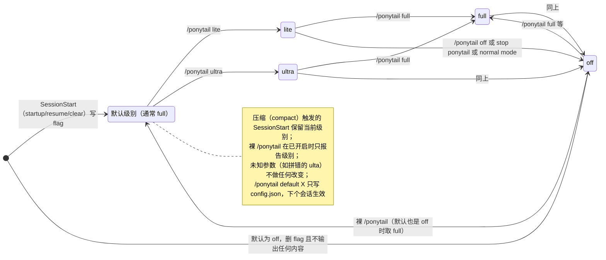

> [!warning] 「文件不存在」到底表示什么？
> 大多数宿主里，flag 不存在就表示 off。但 Qoder **没有 SessionStart**，`mode-tracker.js` 只能把「flag 不存在」理解成「首次运行」，并按默认级别自动打开。如果 off 也用「删除文件」表示，用户刚关掉，下一条 prompt 又会把它打开。所以 Qoder 的 off 写成内容为 `off` 的文件（#676）。
> **同一个「不存在」不能同时承载两种语义**，这是状态设计里很常见的坑。

> [!warning] 「会话级」的真实含义
> 按项目隔离后，**不同仓库**里并发的 Claude Code 会话互不影响，但仍有三处共享：
> - **同一个仓库**里的并发会话共用一份项目 flag。代码自己标了 `ponytail: sessions in the SAME repo still share one mode … key by session_id if either matters`。
> - statusline 和 band 读的是共享 flag，显示的是「最后一次写入」，不一定是当前会话的级别（band 的 `readLevel` 也为此标了一条 `shortcut:` 注释）。
> - 宿主没有设置 `CLAUDE_PROJECT_DIR` 时只有一个共享 flag。Cursor 会把工作区根同时设成 `CURSOR_PROJECT_DIR` 和别名 `CLAUDE_PROJECT_DIR`，所以 Cursor 下也按项目隔离（`~/.cursor/ponytail-modes/`），`docs/cursor-hooks.md` 也写明了这一点。
>
> 另外，新会话、`/resume`、`/clear` 触发的 SessionStart 都会把（该项目的）flag 重置回默认级别；只有**上下文压缩**例外：`activate.js` 从 stdin 读到 `source: "compact"` 时沿用当前级别（关着就保持关着，`:189-193`），否则一次自动压缩就会把用户切好的 lite 或 off 悄悄改回 full（#1074）。所以「只影响当前会话」，准确说是「同一项目内、直到下一次新会话 / resume / clear」。

### 3.7 组件怎么协作

把前面几节的部件放进一张图：谁读谁、谁写谁。

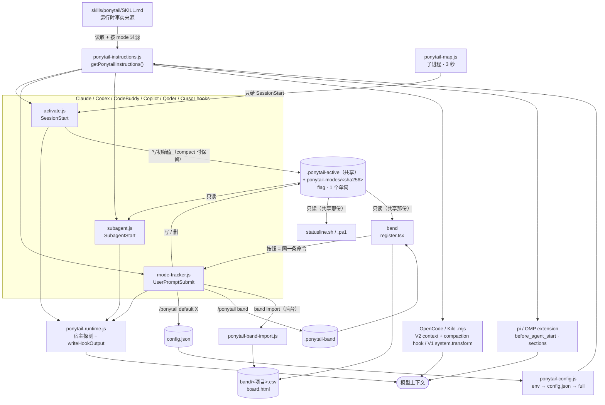

**四条协作链路**

1. **注入链**：`config.js` 解析级别 → `instructions.js` 构建文本（SessionStart 时再拼上 `map.js` 子进程输出的地图）→ `runtime.js` 按宿主协议写 stdout（或由插件直接改 system prompt）→ 进入模型上下文。各宿主的注入时机不同：
   - Claude Code：会话开始（含压缩后）+ 每个子 agent
   - Codex、Cursor：会话开始 + 切换级别时
   - OpenCode、pi、Qoder：每轮（OpenCode 包括压缩请求）
   - Hermes：首轮 + 级别变化或被压缩之后
2. **状态链**：`activate.js` 写初始值，之后的全部写入和删除都由 `mode-tracker.js` 负责。flag 文件是唯一的事实来源（Claude Code 下优先读按项目那份），`statusline`、`subagent.js` 和 band 都**只读**；band 切级别也是去执行 `/ponytail <level>` 这条命令，由 `mode-tracker.js` 写。
   - `/ponytail lite`：只改 flag，**直到下一次新会话 / resume / clear**（见 [[#3.6 运行时状态机]] 的并发警告）
   - 裸 `/ponytail`：off 时按默认级别打开，已开启时只报告
   - `/ponytail typo`：什么都不做
   - `/ponytail default lite`：只写 `config.json` 做持久化，不改当前 flag（Qoder 这一轮照常带上规则，因为它每轮都靠这次注入）
3. **度量链**（仅 Claude Code）：band 订阅会话事件 → 更新状态 → 每轮写一行 CSV 并重建 board（可选发 webhook）；`band import` 把历史会话补进同一份 CSV。
4. **一致性链**（CI）：`check-rule-copies.js` + `check-versions.js` + `npm test`（含 OpenClaw 产物过期检查）+ benchmark `--selftest`，保证各宿主的文本、版本号和评分器不漂移。

**Skill 之间的协作**

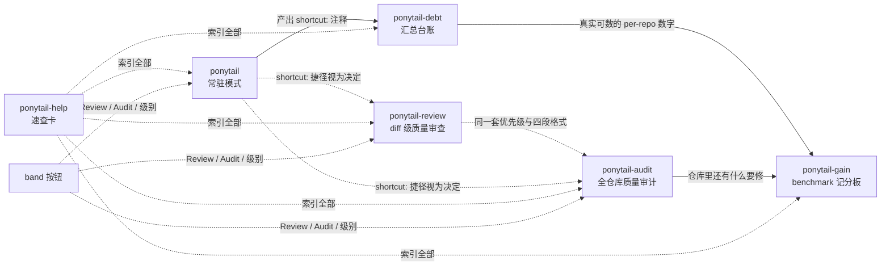

主模式常驻，其余五个都是**一次性（one-shot）命令，默认不改文件**。唯一的例外是 `ponytail-debt`，用户要求时会把台账写成文件。Codex 里用带命名空间的 `$ponytail:ponytail-review` 调用 skill。

---

## 4. 项目特色：其他核心内容

前三章讲完了「送什么」和「怎么送」。这一章是 Ponytail 作为工程项目最有特色的五块：30 多处文本怎么保证不走样（4.1），「先复用」怎么做到不花成本（4.2），怎么看见规则到底有没有被执行（4.3），一段提示词的效果怎么测（4.4），以及写 hook 踩过的坑（4.5）。

### 4.1 防漂移机制（仓库里真正的「代码」）

Ponytail 的工程含量主要在这一部分：

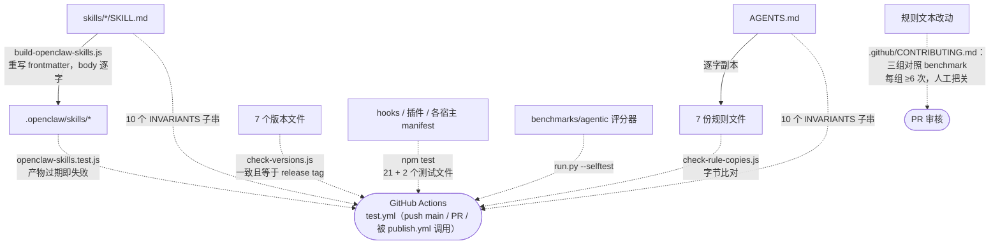

- **`scripts/check-rule-copies.js`**：7 份 instruction-tier 副本逐字比对 `AGENTS.md`。比对前统一 CRLF→LF 并 trim，剥掉 `.mdc` 和 Kiro 文件的 frontmatter，`AGENTS.md` 去掉末尾的自指段。
- **同一个文件里的 `INVARIANTS` 数组**（`:44-56`）：SKILL.md 比 AGENTS.md 多出 Levels 表，没法字节比对，于是钉住 **10 个关键子串**当金丝雀（矿井里先替人报警的鸟：哪句被删，CI 先变红），要求在两个文件里**都**出现：

  ```js
  'in this codebase'                          // 第 2 步：复用已有代码
  'grep every caller'                         // 根因修复
  'never about the change itself'             // 范围：调用方、测试、fixture
  'shortcut: <the limit>, <when to upgrade>'  // shortcut: 注释格式
  'correct on edge cases'                     // 选稳健：边界正确
  'Lazy code without its check is unfinished' // 测试下限
  'validation at trust boundaries'            // ┐
  'prevents data loss'                        // │ Never cut 六项里钉了四项
  'security'                                  // │ 硬件校准、「用户要求的一切」没钉
  'accessibility'                             // ┘
  ```

  代码里自己标了 `ponytail: canary, not full equality`，升级路径是「如果漏掉了真实漂移，就改为从 SKILL.md 生成副本」。

  > [!caution] 金丝雀有盲区
  > 一个单词 `security` 在提示词里出现两次，Never cut 六项只钉了四项，详见 [[#5.3 局限二：防漂移的盲区]]。

- **`scripts/build-openclaw-skills.js`**：OpenClaw 要求 description 单行、不含引号、少于 160 字符，所以**只重写 frontmatter，body 逐字复制**。`tests/openclaw-skills.test.js` 检查提交的产物是否过期。
- **`scripts/check-versions.js`**：**7 个**版本文件（Claude、Codex、Devin、Copilot、Qoder 五个 `plugin.json`，加上 `gemini-extension.json` 和根 `package.json`）必须是同一个固定的 `X.Y.Z`（当前 `5.3.3`），在 release tag 上还必须等于 tag。只检查「彼此一致」是不够的：所有 manifest 可能一起停在旧版本，彼此一致却全错（#260）。
- **CI 拓扑**：`test.yml` 依次跑 `check-rule-copies.js`、`check-versions.js`、`npm test`，最后跑 `python3 benchmarks/agentic/run.py --selftest`（不调 API，验证 benchmark 评分器本身没坏）。它不直接监听 tag，而是由 `publish.yml`（`push tags: v*`）通过 `workflow_call` 调用，`needs: test` 通过后才执行 `npm publish`，所以 tag 校验仍在 tag 上下文里执行。所有 action 钉到 commit SHA，`permissions` 默认 `contents: read`，只有 publish job 拿到 `id-token: write`（OIDC 可信发布），`npm` 固定为 `11.5.1` 而不是 `@latest`。这是供应链加固的标准做法。
- **测试**：`npm test` 跑 `tests/*.test.js`（21 个文件），加上 `pi-extension/test/` 的 2 个文件。绝大多数测试验证的是**适配器接口约定**：hook 输出形状、Windows 行为、frontmatter 解析、各宿主 manifest、卸载脚本、代码地图（`map.test.js`、`activation-map.test.js`）、`band import`（`band-import.test.js`）。`behavior.test.js`、`correctness.test.js`、`loc.test.js` 测的是早期 promptfoo 单次生成 benchmark 的**评分器**（`benchmarks/*.js`）。CI 里**不调用任何模型**，所以提示词的**效果**只靠 benchmark 离线验证。本地实测（96608e0，Node 24）：主套件 144 个测试通过 143 个，唯一失败的是 `csv: correct pandas one-liner passes`（本机没装 pandas，CI 会 `pip install pandas`）；pi 套件 30 个全部通过；`run.py --selftest` 输出 `all instruments valid`。`tests/band.test.tsx`（30 个用例）不在 `npm test` 的通配范围内，见 [[#5.3 局限二：防漂移的盲区]]。
- **效果靠 benchmark 把关**：CI 不调用任何模型，只能证明文本没走样；规则改了以后效果有没有退化，靠改规则必须附三组对照 benchmark 的人工把关，见 [[#4.4 Benchmark：怎么测一段提示词]]。

> [!warning] 这类项目的真实风险是「文本漂移」
> 提示词项目没有编译器。30 多个宿主加上手工复制，必然会出现不一致。Ponytail 的答案是**把一致性变成 CI 断言**：能字节比对的就比对，不能比对的就钉关键子串当金丝雀；**效果**则交给 benchmark 把关。

### 4.2 代码地图：给「先复用」一张清单

`hooks/ponytail-map.js`（111 行）在 SessionStart 时列出项目里「已经存在的东西」，附在规则后面一起注入。文件头一句话说明了动机：*"what already exists, so 'reuse first' costs no search."*

这是**为提示词里的第 2 步提供运行时支撑**：规则说「先看代码库里有没有」，地图就让「看」这一步几乎免费。band 的复用率则从另一头检验这一步：改完之后，新代码到底调用了多少已有定义。

```text
Codebase map (what already exists; reuse it, read a file only when you need its details):
src/lib/: slugify, formatMoney, parseDate
src/components/ui/: Button, Input, Dialog, ...
app/services/: send_email, charge_card
(3 more folders not listed)
```

| 设计点     | 做法                                                                                                                                           |
| ------- | -------------------------------------------------------------------------------------------------------------------------------------------- |
| 运行方式    | `activate.js` 在子进程里运行它（`require.main === module` 分支），3 秒超时；也可以手动 `node hooks/ponytail-map.js [目录]`                                           |
| 取文件     | `git ls-files`（3 秒超时，输出缓冲 64 MiB，大仓库不会因为溢出被误判成「不是 git 仓库」，#1156）；不是 git 仓库时，退回最多 6 层的目录遍历                                                    |
| 识别定义    | 每种语言一组正则：Python 顶层 `def`/`class`，JS/TS 的 `export …`，Go 的大写 `func`/`type`，Rust 的 `pub`，Ruby，JVM 系的 `class/interface/enum/record`              |
| 跳过      | 测试、fixture、迁移、`dist`/`build`/`vendor`/`node_modules`、`.min`/`.d.ts`/`.gen` 文件，以及 `_` 开头的私有名                                                  |
| 输入当作不可信 | 路径必须只含普通字符（`SAFE_PATH`），名字必须是合法标识符（`NAME`），符号链接一律跳过（`lstat().isFile()`）。地图是**把仓库内容直接写进模型上下文**的通道，奇怪的文件名或指向仓库外的链接都可能把不该进的文字带进去（#1070）         |
| 预算      | 默认 2000 字符（`PONYTAIL_MAP_CHARS`）；一个目录一行；目录下文件超过 8 个时每个文件只取 1 个名字，否则取前 3 个                                                                    |
| 优先级     | 路径含 `util/helper/lib/common/shared/service/component/hook/core/model/schema/api` 的排在前面                                                       |
| 失败处理    | 子进程超时或出错就不加地图；`PONYTAIL_MAP=0` 可以关闭                                                                                                          |
| 测试      | `tests/map.test.js`（含恶意目录名的用例，操作系统不允许建这个目录时跳过）、`tests/activation-map.test.js`（地图在 SessionStart 里的超时与降级）                                      |
| 自我标注    | `ponytail: regex, not a parser. Misses nested or dynamic definitions; a tree-sitter index is the upgrade if the map ever needs to be exact.` |

地图的两个盲区（看不见 CommonJS、覆盖面有限）见 [[#5.3 局限二：防漂移的盲区]]。

### 4.3 Band 与 Board：Claude Code 里的度量层

第 3 章都在回答「规则怎么送进去」。band 回答的是另一个问题：**规则送进去之后，agent 到底照做了没有，花了多少钱？** 它只在 Claude Code 里出现（需要 2.1.290 或更高版本，终端或桌面版；VS Code 聊天面板、云端会话和 `claude -p` 里不显示）。

**挂载方式**：`.claude-plugin/plugin.json` 的 `hooks` 是一个数组，第二项 `hooks/claude-band.json` 只有两行有效内容：`"hooks": {}` 和 `"modules": ["./band/register.tsx"]`。空的 `hooks` 记录是给不支持 mod 的旧版 Claude Code 留的：它照常加载插件，只是看不到 band。同一个 manifest 还声明了 `types`（`hooks/band/types.d.ts`，给 band 的状态加类型）和 `userConfig`（4 个用户可配项，见下表）。

| 文件 | 行数 | 角色 |
|---|--:|---|
| `hooks/band/register.tsx` | 495 | 订阅 Claude Code 事件、更新状态、画 band、写台账 |
| `hooks/band/metrics.ts` | 311 | **纯函数**（不碰 `$`，测试直接调用）：定义提取、复用统计、项目范围判断、测试命令识别、CSV、Markdown、webhook 请求 |
| `hooks/band/board.ts` | 560 | 把所有 CSV 台账渲染成一个自包含的 `board.html` |
| `hooks/band/types.d.ts` / `logo.ts` | 34 / 3 | 状态类型；logo 路径数据 |
| `hooks/ponytail-band-import.js` | 274 | `/ponytail band import`：把过去的 Claude Code 会话补进台账 |

**事件 → 状态**：状态存在一个 `atom({ plugin: 'ponytail', key: 'band' })` 里，每次读取都先和空状态合并，旧版本存下的状态缺字段也不会出错。

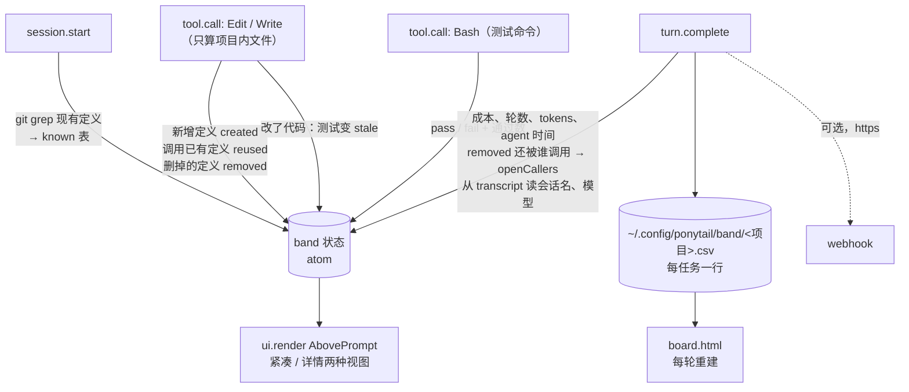

- **复用率**：会话开始时用 `git grep` 列出仓库里已有的顶层定义（name → `file:line`）。每次 Edit / Write，比较改动前后的文本：新出现的定义算 `created`；新增行里调用了已有定义算 `reused`（`main`、`get`、`render` 这类太泛的名字不算）。复用率 = reused / (reused + created)，**少于 3 个时不显示**，免得「新写了 1 个 helper」显示成「0% 复用」。
- **只算项目内的文件**：Edit / Write 的目标如果不在项目根目录（git 仓库根，没有仓库就用工作目录）下面，直接跳过，不计入复用、删除的定义和测试状态。项目外的临时脚本既不会被项目调用，也不会复用项目里的代码，算进来只会污染读数（#1300）。
- **没修完的调用方**：被删掉或改名的定义，如果在仓库里没有被重新定义、却还有地方在调用，就记成 `callers open`，并给出 `file:line`。这正是提示词里「grep every caller」的**运行时检查**。
- **测试状态**：Bash 里跑的命令匹配常见测试命令（`npm test`、`pytest`、`go test`、`cargo test`……）就记下通过或失败，并从输出里解析通过数和失败数；之后只要再改了代码文件，状态就变成「no test since change」。这对应提示词的测试下限。
- **成本**：每轮从 `$.session.usage()` 读会话总成本，减去上一轮的值得到这一轮的花费；子 agent 的 tokens 单独累加，它的成本已经包含在会话总成本里，不重复计算。

**界面**：紧凑视图是一行（级别、总花费、上一轮花费、agent 时间、复用率、待修调用方、测试，右侧 Review / Audit / Board / Details 按钮）；详情视图是四个级别按钮加一排指标列（花费、tokens、agent 时间，以及有数据时才出现的复用率、调用方、测试）。终端里整行宽度按字符格数 `bodyColumns` 设定；桌面版和 VS Code 里按钮比字符格宽，按格数定宽会折行，所以交给布局自动分配（#1302）。桌面版里这排指标画成 SVG，因为比例字体下的字符画线条会断。同一个位置可能还有别的 mod，band 先 `next(e)` 拿到它们的渲染结果，再把它们叠在自己下面，而不是覆盖掉（#1146）。

> [!tip] band 的按钮不自带逻辑
> 级别按钮执行的是 `$.command.run({ command: 'ponytail:ponytail', args: level })`，Review / Audit 执行的是 `ponytail:ponytail-review` / `ponytail:ponytail-audit`。代码注释写的是 "The same commands a person types, so ponytail's own skills and hooks stay the only logic." 这就是 [[#3.3 三层注入（tier 模型）]] 里那条 Adapter Rule 在 UI 层的样子：**界面也是一个轻量适配器**。

**台账与 board**：每一轮结束，把当前任务写成 CSV 的一行（主键是 `会话 id 前 8 位-开始时间`，`/clear` 之后算新任务），同一任务的行原地替换；然后从所有项目的 CSV 重建 `board.html`。这个页面是**完全自包含**的：内联 CSS、内联 SVG、几行脚本，不联网；任务名只通过 `textContent` 进入页面，嵌在 `<script>` 里的 JSON 会转义 `<`，任何任务名都关不掉这个脚本块。

| `userConfig` 项 | 默认 | 作用 |
|---|---|---|
| `ledger` | `true` | 每轮写本地 CSV 台账和 board |
| `webhookUrl` | 空 | 每轮把这一行以 JSON 发到这个地址（团队看板、n8n、表格脚本）；空 = 数据不出本机 |
| `webhookToken` | — | `sensitive: true`，存在系统钥匙串里，不进任何设置文件或仓库 |
| `sendNames` | `true` | 是否把任务名发给 webhook；关掉后 board 上显示无名任务 |

webhook 只接受 `https`（`localhost` 上的 `http` 例外，方便本机看板），token 只随 HTTPS 发送；请求**不等待**结果，慢的端点不会拖住这一轮。

**命令**（只在原生 Claude Code 里生效；其他宿主没有 band，`band` 这个词会被当成未知参数忽略）：
- `/ponytail band`：显示 / 隐藏切换；`/ponytail band on|off` 直接设定。状态是 `~/.claude/.ponytail-band` 文件，内容 `off` 表示隐藏，**不存在表示显示**；级别不受影响。
- `/ponytail band import`：`mode-tracker.js` 以 `detached` 方式后台启动 `ponytail-band-import.js`，立刻回复，不让 prompt 等着读历史记录。导入器逐行读 transcript（单个会话的 JSONL 可能超过 500 MB），用代码里一张按模型列出的价格表估算成本；**价格表里没有的模型或 fast 模式的回复不估算，成本留空**（"an empty cost beats a guessed one"）。没人打过字的会话（benchmark、`claude -p`、脚本）跳过；worktree 归到它的主仓库；台账里已有的会话不重复导入。导入器和 band 写的是同一套 CSV 列，`band-import.test.js` 从 `metrics.ts` 里读出列头比对，保证两边一致。

> [!important] 和 `/ponytail-gain` 的诚实性边界一致
> band 只报告**这个任务实际发生的事**（花了多少、复用了多少、测试过没过），从不报告「你因此省了多少行」。没写出来的那个版本从未存在，没有基线可减（见 [[#反幻觉的诚实性边界]]）。

> [!example] 这一层也到处是 `shortcut:` 注释
> `register.tsx` 和 `metrics.ts` 一共 10 条：级别读共享 flag；没有 `grep`（Windows）时只能读 4 MiB 以下的 transcript 拿会话名；台账只放 `~/.config`，Windows 更适合 `%APPDATA%`；关掉会话持久化时没有 transcript 文件，每轮都要把所有项目目录找一遍；调用方按名字匹配，别的模块里同名函数也会算进去；复用率少于 3 个不显示；SVG 跟随系统主题而不是应用主题……每一条都写了局限和升级条件。

### 4.4 Benchmark：怎么测一段提示词

提示词没有编译器，效果只能靠实验。第 1 章的数字全部来自 `benchmarks/agentic/`，它的设计本身就值得学。

| 测什么 | 怎么测 | 工具 |
|---|---|---|
| 体积 | 行数（含注释、不含测试）、gzip 压缩后的体积、输出 tokens、成本、耗时；每个任务 5 次取中位数，除以基线，再对所有任务取几何平均，区间来自 bootstrap | `run.py` 采集，`compare.py` 逐任务比较（几何平均与 bootstrap 脚本不在仓库里） |
| 正确与安全 | 隐藏检查用对抗输入实际运行代码；安全要求**隐含**在 prompt 里（"untrusted"、"abusive clients"），看 agent 会不会把它砍掉 | `tasks.py` |
| 完整性 | 只比代码量的题，由模型盲评交付物，0（空壳）到 3（完整实现） | `complete.py` |
| 测试质量 | 往 agent 写的代码里注入小 bug，用 agent 自己的测试去跑（见 [[#规则 8：测试下限]]） | 作者自述随用户版 benchmark 发布，仓库里暂无 |
| 回复 | 盲评两组回复，配对比较 | `answer.py`、`compare.py` |

题目按 tier 分组，每组对准一类失败：scope（改全了没有）、convention（有没有绕开已有结构）、quality（复用、先追根因再修）、safety（安全）、vibe（「build me X」类模糊需求）、open-ended（开放式需求，只比代码量）、tmpl（在真实全栈模板仓库里做前后端任务）。第 2 章大部分「实测」就是从这些题里挑的；规则 5 的「原则 vs 动作」对照来自另一份更早的结果文件。

`benchmarks/` 有两套：
- `promptfooconfig.*.yaml`：单次生成对比，**已被作者自己标注为「基线不公平」**（不装 skill 的基线会用大段说明和多个备选方案把篇幅撑大，#126）。
- `benchmarks/agentic/`：真正的端到端测试。每次运行是一个 headless Claude Code 会话，在临时目录里修改种子代码，按留下的文件打分。`answer.py` 盲评回复，`compare.py` 做配对比较，`complete.py` 给只比代码量的题做完整性评分（只看 agent 的 diff 或聊天里给出的答案，代码里的 `ponytail:` 标记先中和掉以保持盲评，超时被杀的运行单独计数而不是记 0 分）。每个评审器都要先过 `--selftest`（例如完整实现必须严格高于空壳）才算数。

- **规则改动的人工把关**（`.github/CONTRIBUTING.md`）：凡改动 `skills/`、`AGENTS.md`、7 份副本、`.openclaw/skills/` 等「改变 agent 被告知内容」的 PR，都必须附**三组对照** benchmark（baseline / 当前 main / 你的改动，同任务同模型），既要证明目标任务变好，也要证明至少一个已有任务没有变坏，每组至少 6 次，并使用当前模型。否则直接关 PR。hooks、安装器、适配器、文档的 bug 修复不受这条约束。
- **当前规则的来历（作者自述）**：结果文件写明，每一处规则改动都必须在配对运行里跑赢当时的版本，一次只改一处；最后再把各组放在同一轮里做最终对比，让一天中的时段和模型漂移对各组的影响相同。

### 4.5 工程经验：写 hook 踩过的坑

> [!warning] 这些全是真实事故留下的疤痕，写 hook 的人值得逐条看

**进程与事件循环**

- **永不阻塞会话，以及「兜底代码恰好是死代码」的教训**：`mode-tracker.js`、`subagent.js`、`activate.js` 三个读 stdin 的 hook 都挂了 `stdin error` 处理和 1 秒 `setTimeout` 兜底。原因是 Windows 上 Claude Code 用 PowerShell `if {}` 包装 hook，会吞掉管道里的 JSON，导致 `end` 事件永远不触发，**整个会话冻结**（#443）。这个定时器曾经带 `.unref()`，以免给正常路径增加延迟。但作者在 #790 里观察到：Windows 上 stdin 卡住时，unref 的定时器**始终没有触发**（提交说明的解释是 ref 的 stdin 句柄撑着事件循环；按 Node 的一般语义，unref 只是不阻止进程退出，所以这是 Windows 上的实测现象，不是 unref 的通用行为）。兜底恰好在它要兜的那种情况下失效，hook 一直挂到 Claude Code 外部的看门狗把它杀掉。所以定时器必须保持 ref，改为在 `end` 回调里显式 `process.exit(0)` 来消除正常路径的 1 秒延迟。`subagent.js` 更进一步：没有设置 matcher 时**根本不读 stdin**，同步注入后立即退出。
- **`process.exit()` 会吃掉还没写完的输出**（#1043、#1112）：每个 hook 写完输出就立刻 `process.exit()`。在 macOS 上管道写入是异步的，`process.stdout.write()` 还没刷出去，进程就退出了，规则根本没送到模型。现在所有输出都走 `fs.writeSync(1, …)`，同步写完再退出。
- **正则也会卡死事件循环**（#658）：`PONYTAIL_SUBAGENT_MATCHER` 是用户提供的正则。`(a+)+$` 这类回溯型正则的 `.test()` 是同步执行的，会堵住事件循环，上面那个 1 秒兜底同样永远轮不到。所以用 `vm.runInNewContext('re.test(s)', …, { timeout: 100 })` 执行匹配，超时按 fail-open 处理（照常注入）。
- **慢的可选步骤放进子进程，给它一个远小于总上限的预算**（#1079、#1166）：代码地图 3 秒，hook 总上限 15 秒。可选功能超时只损失它自己，不会把必需的规则一起拖死。
- **默认缓冲区也是一种静默失败**（#1156）：`execFileSync` 默认最多收 1 MiB 输出，大仓库的 `git ls-files` 超过后抛错，被 `catch` 当成「不是 git 仓库」，转而走不读 `.gitignore` 的目录遍历。错误被吞掉之后，降级路径悄悄换掉了语义。
- **后台任务要 `detached`**：`/ponytail band import` 要读很多 transcript，`mode-tracker.js` 以 `detached: true, stdio: 'ignore'` 启动导入器，自己马上回复并 `process.exit()`，导入器不受影响。

**失败策略**

- **全链路静默失败**：flag 写失败、statusline 探测失败、stdout EPIPE，全部 `catch` 后继续。**宁可不生效，也不能让 hook 报错。** `node` 不在 PATH 时：Copilot 的命令带 `|| exit 0` 和 `Get-Command` 守卫；Claude 和 Codex 的 hook 没有这层守卫，每次 hook 调用会显示一个无害的 `node: command not found`。band 的每个事件处理器也都挂着 `.catch(($, e, next) => next(e))`：出错就当自己不存在，把事件交给下一个处理者；写台账失败只在状态栏提示一行。
- **失败开放（fail-open）**：subagent matcher 正则写错、正则超时、payload 解析失败、`agent_type` 缺失、stdin 超时，**一律注入**。只有「明确不匹配」才跳过。限定范围的机制（matcher）绝不能悄悄把规则丢掉。代码地图也一样：构建失败就不加地图，绝不阻塞会话开始。
- **off 就真的什么都不说**：默认级别为 off 时，SessionStart 只清理残留状态，不输出任何内容，连空对象都不发。
- **但在「上下文会被重放」的宿主里，关闭也要说出来**（#1122）：Hermes 会把之前注入的规则存在 `api_content` 里每轮重放。如果 off 时什么都不注入，旧规则照样在上下文里，等于没关。所以 Hermes 下 off 注入一行 `PONYTAIL MODE OFF`；从来没开过的会话则什么都不发。
- **未知参数什么都不做**：`/ponytail ulta`、`/ponytail status` 这类参数不会把会话重置回默认级别，当前级别保持不变。
- **不合法的用户配置：报错，不覆盖**（#1059）：`cursor-hooks.js install` 发现 `hooks.json` 不是对象、`hooks` 不是对象或某个事件不是数组时，直接报错退出，提示 "nothing was changed"。把用户写坏的配置「修」成空对象，等于删掉用户的其他 hook。

**输入卫生**

- **UTF-8 BOM 剥离**：读 JSON 的地方都先 `.replace(/^/, '')`（`ponytail-config.js`、`activate`、`mode-tracker`、`subagent`、`check-versions`、`uninstall`、`cursor-hooks`）。Windows 编辑器保存的 JSON、某些 shell 管道会带 BOM，`JSON.parse` 遇到它直接报错。Python 侧用 `encoding="utf-8-sig"` 读取配置。
- **配置值先归一化**：`PONYTAIL_DEFAULT_MODE=' lite '` 或以换行结尾的配置值，都会先 trim 并转小写，而不是被静默忽略。
- **关闭指令必须整句匹配**：`isDeactivationCommand()` 要求整条消息（忽略大小写和结尾标点）就是 `stop ponytail` 或 `normal mode`。如果用子串匹配，「加一个 normal mode 开关」这类正常需求就会**在任务中途把 ponytail 关掉**。
- **进上下文的仓库内容要过滤**（#1070）：代码地图只收普通字符组成的路径和合法标识符，跳过符号链接。
- **进网页的用户内容只当文本**：board 用 `textContent` 放任务名，内嵌 JSON 转义 `<`。

**Shell 注入防护（两层）**

- 生成命令文本时，`isShellSafe()` 用**白名单**（`/^[A-Za-z0-9 _.\-:/\\~]+$/`）。恶意 clone 路径（含引号、`&`、`$`、反引号、`;`）会走手动配置分支，而不是逐个 shell 做转义。注释里明确写了这是权衡：*"An allowlist beats escaping every shell's metacharacters."* statusline 引导、过期路径检测和 Cursor 安装脚本都经过这道检查。
- 宿主 hook 配置里，**根本不把路径拼进 shell 文本**：`node -e "require(…process.env.CLAUDE_PLUGIN_ROOT…)"`，路径作为环境变量传进 Node，由 `path.join` 处理，shell 永远看不到它。这比白名单更彻底：**不需要判断是否安全的数据，就不要让它进入解释器。** band 调外部程序时也一律用参数数组（`$.process.run(['git', 'grep', …])`），不拼命令字符串。

**宿主差异**

- **宿主探测的顺序本身就是逻辑**：CodeBuddy 和 Cursor 跑 Claude 格式插件时**同时**设置 `CLAUDE_PLUGIN_ROOT` 和自己的变量，但它们要的是各自形状的 JSON。所以 `isCodeBuddy`、`isCursor` 必须排在「默认 Claude」之前，又要排在有自己数据目录的 Copilot、Codex、Qoder 之后。选 `CURSOR_VERSION` 是因为它只出现在 Cursor 构造的 hook 进程环境里（注释写明对照了 Cursor 3.20.17）。
- **VS Code Copilot 探测**：它不设 `COPILOT_PLUGIN_DATA`，只注入一个指向 `.vscode/…/agent-plugins/` 的 `CLAUDE_PLUGIN_ROOT`，所以只能靠路径特征识别。否则会被当成原生 Claude Code，输出它读不到的 statusline 引导。
- **会被当成警告的状态提示要删掉**：Codex 把 `systemMessage` 显示成黄色的 `warning:`，还把 hook 完成标记从绿色改掉，用户每次开会话都会以为出错了。所以干脆不发 `systemMessage`，并留下一条 `ponytail:` 注释：如果 openai/codex#16933 落地导致 additionalContext 也被隐藏，再找一个不像警告的级别信号。
- **Qoder 一次只写一个 JSON**：切级别时把「MODE CHANGED」确认并入规则头部，避免 stdout 上出现两段 JSON；`/ponytail default X` 的确认也并进这一轮的规则里，而不是提前返回把这一轮的规则丢掉（#1114）；裸 `/ponytail` 只报告时也不能多写一次。
- **band 只在原生 Claude Code 里响应 `band` 参数**：Copilot、Codex、Qoder、CodeBuddy、Cursor 跑的是同一个 `mode-tracker.js`，但它们没有 band，`band` 在那里只是一个未知参数。
- **Windows 没有 `HOME`、没有 `mkdir` 命令**：band 先读 `HOME`、再回落到 `USERPROFILE`（#1144）；写台账直接用会自动建目录的 `$.fs.write`，不调用 `mkdir`（#1145）。
- **只靠某个 hook 传进来的数据，要假设那个 hook 可能不运行**（#1242）：在托管设置、Team、Enterprise 环境里，Claude Code 的 `cc-plugin-sec-default` 排在最外层，会跳过所有 mod 的 `classic.*` hook。band 原本只能从 `classic.UserPromptSubmit` 的输入里拿到 transcript 路径，在这些机器上就读不到会话名和模型。所以现在由 `turn.complete` 自己找 `<会话 id>.jsonl`：先查 Claude Code 命名规则对应的那个目录，找不到再逐个查所有项目目录（目录名超过 200 字符会被哈希，`/cd`、worktree、`/resume` 也会让文件落在别处）。上一轮存下的路径，只有文件还在、文件名也对得上当前会话时才沿用。
- **订阅范围要和用途一样窄**（#1291）：band 监听 `command.run`，只是为了在 `/clear`、`/resume`、`/branch` 换了会话 id 之后重建状态。但这个处理器没设 matcher，就挂进了每一条斜杠命令的处理链；Claude Code 会把处理链经过的插件都标在命令输出前面，别的插件的命令输出也被标成 `ponytail+<插件名>:`。现在只订阅这三条命令。道理和 subagent matcher 一样：不该经手的事件，就不要经手。
- **装饰性元数据也能关掉功能**（#1021）：根 `plugin.json` 曾加过 agent-plugins.org 的 `$schema`，本意只是规范化。结果 Codex、VS Code 和 Qwen 一看到这个 schema，就按「只有 skills」的模式加载插件，**hooks 和常驻上下文全部静默丢失**。所以现在根 `plugin.json` 不带 `$schema`。manifest 里看似装饰的字段，可能被某个宿主当成模式开关。反过来，Hermes 的安装检查又**要求**这个 schema，`hermes plugins install` 会报错，INSTALL.md 只能给出手动 `git clone` 到 `~/.hermes/plugins/` 的绕行办法，等 Hermes 修复。同一个字段，一个宿主见了就降级，另一个宿主没有就拒装。
- **小图标就该是小图标**（#1164）：Codex 的 composer 图标原先指向 554 KB 的 logo，现在换成单独的小图 `assets/codex-icon.png`。

CI 管不到的副本和二次实现（Python fallback、#875 双实现、README 资产、价格表、band 测试）见 [[#5.3 局限二：防漂移的盲区]]。

---

## 5. 总结与局限

### 5.1 适合哪些场景

| 场景 | 为什么合适 |
|---|---|
| 已有一定规模的代码库，日常加功能、修 bug | 里面有自家组件、工具函数和约定，「先复用」这一步收益最大；代码地图让复用几乎不花搜索成本 |
| 多种 AI 工具混用的团队 | 一份规则送进 35 个具名宿主，不用每个工具单独维护一套提示词 |
| 在意 review 负担和成本的团队 | 代码少一半，回复结尾直接说明还有什么没做、有什么风险；用 Claude Code 的话，band 把每个任务的成本、复用率、测试状态摆在眼前，webhook 还能汇总到团队看板 |
| 想写自己 `AGENTS.md` 的人 | 仓库里的 `AGENTS.md` 只有 32 行，就是一份可以直接抄的最小集（见 [[#5.5 总结：带走什么]]） |

**按场景选级别**：
- 需求已经很明确：`lite`，照要求做，更小的方案用一行点出来让你选
- 日常默认：`full`
- 需求还在讨论，想让它帮你挑战一下：`ultra`，动手前先质疑需求里没有必要的部分

> [!note] 选宿主时注意档位
> 只有 plugin-tier 宿主能切级别；拿到代码地图的更少，只有走 `activate.js` 的那几个；band 和 board 只有 Claude Code 有。instruction-tier 宿主只有常驻规则（见 [[#3.3 三层注入（tier 模型）]]）。

### 5.2 局限一：证据口径窄

> [!note] 这些数字只能这样读
> - **作者自报**：没有第三方复现。结果文件说测试和变异工具「随用户可运行的 benchmark 一起发布」，但仓库里还找不到它们，68%→98%、46%→66% 两组目前无法独立复现。
> - **只测了一个模型、一个宿主**：Opus 5.5 + Claude Code。结果文件自己也写明「这一轮只覆盖 Claude Code」，Codex、Cursor、Copilot 等宿主没测。
> - **agent 不能跑代码**：Bash 被禁用，测试由 benchmark 事后去跑。测的是「写出来的东西」，不是「调试能力」。
> - **39 个任务中有 21 个没有隐藏检查**，它们只比代码量。完整性评审补上了一部分：这 21 道题两组都是全部完整实现；但评审本身也是一个模型，而且只看 diff（有一次就因为看不到 diff 之外的 import 误判，作者人工改判）。
> - **隔离**：每个会话都在 git 仓库之外的全新临时目录里跑，关闭 `CLAUDE.md` 和 auto memory，只加载被测插件。
> - **测试分类是作者自己定的**：哪些任务「需要测试」在运行前就固定下来；算出 -53% 等数字的几何平均与 bootstrap 脚本也不在仓库里（`compare.py` 只做逐任务中位数比和符号检验）。
> - **质量是持平，不是提升**：安全题 30/30 持平，隐藏检查 95.6% 对 96.7%。单个测试的质量反而是不装 skill 更高：只看写了测试的运行，注入的 bug 被抓到 77% 对 69%。它写出的测试更扎实，只是常常干脆不写。
> - **换个模型未必成立**：每一处删减都只在 Opus 5.5 上验证过，模型更弱时，极简提示词的省略未必还成立（见 [[#2.4 Never cut：底线清单]]）。

### 5.3 局限二：防漂移的盲区

防漂移 CI 只管得到它断言过的东西。本仓库现存的漂移和风险，全部出在 CI 没覆盖的地方。

> [!caution] 金丝雀的盲区
> `'security'` 是一个很宽的单词。SKILL.md 第 41 行有 `money or security`，第 44 行的 Never cut 里也有 `security`。所以**把第 44 行的 `security,` 删掉，这条金丝雀照样通过**。`'accessibility'` 目前只出现一次，暂时安全。另外，Never cut 一共六项，只钉了其中四项：硬件校准和「用户要求的一切」被改写删掉也不会报错，尽管 `check-rule-copies.js:51` 的注释写的是 "pin each"。子串金丝雀只防「整段改写」，不防「精确删掉一个词」；要更严格，就钉更长的短语（例如 `'data loss, security, accessibility'`）。

**CI 管不到的副本**

- **fallback 文本：JS 和 Python 不一致**。JS 的 `getFallbackInstructions()` 逐字等于 `AGENTS.md`（但**没有测试锁定**，只靠一行注释 "the same rules as AGENTS.md"）。Python 的 `_fallback_instructions()`（Hermes 插件 `__init__.py:89-99`，读不到 SKILL.md 时使用）是一段自己概括的文字，只保留了范围清单、六步阶梯、「不加没人要的抽象」和 Never cut 的大部分，至少缺 10 项：回复结尾约定、"never about the change itself"（它本身还是 CI 金丝雀）、最短 diff 与「一行要一眼看懂」、只注释为什么、grep 调用方、搬代码保留校验、边界正确、测试下限、`shortcut:` 注释、硬件校准。两份 fallback 都**不在** `INVARIANTS` 检查范围内。
- **同一条规则的两份实现**：Python 的 `_filter_skill_body_for_mode` 必须和 JS 的过滤器保持同样的正则条件和换行处理（用 `re.split(r"\r?\n", …)` 而不是 `splitlines()`，后者会吞掉结尾换行）。这两处曾经一边修了、另一边没修（#875）。
- **README 资产**：阶梯图是 7 级，规则是 6 步；徽章写「20 agents」，适配矩阵列了 35 个。
- **价格表**：`ponytail-band-import.js` 里有一张手抄的模型价格表（注释写着 2026-10-17 对照官方价格页核对过）。这是又一份「从外部抄进来的事实」，官方调价或出新模型时不会有任何检查报警；好在缺价时成本留空，而不是猜一个。

> [!bug] README 的阶梯图和规则对不上
> `assets/v5/ladder.png` 的替代文字是「1 does this need to exist … 3 does the standard library do it, 4 a native platform feature … 7 only then the minimum」，共 7 级，标准库和平台特性分开。而 SKILL.md 是 6 步。**图片是 CI 管不到的又一份副本**。

> [!caution] band 的测试不在 CI 里
> `tests/band.test.tsx` 有 30 个用例，用的是 `claude-code/testing` 测试框架，但 `npm test` 的命令是 `node --test tests/*.test.js`，`.tsx` 文件不在通配范围内，CI 也没有别的步骤去跑它。仓库里最大的一块 TypeScript 代码（`register.tsx` + `metrics.ts` + `board.ts` 共 1,366 行）在 CI 里**一个测试都不执行**。`metrics.ts` 特意写成不碰 `$` 的纯函数「so the tests call them directly」，可这些测试只在作者本机跑。只有 `band import` 的 `band-import.test.js` 在 CI 里。

> [!caution] 地图的两个盲区（本地实测 96608e0）
> 1. **看不见 CommonJS**：JS 的正则只认 ESM 的 `export`，`module.exports = {…}` 完全识别不到。在 Ponytail 自己的仓库上跑，地图 5 行（583 字符），`hooks/band/` 这样的 TS 目录列出来了，`hooks/`、`scripts/` 两个 CommonJS 目录**一个名字都没有**，尽管 `hook` 正好在优先目录列表里。
> 2. **覆盖面有限**：只有走 `activate.js` 的宿主（Claude Code、Codex、CodeBuddy、Copilot CLI、Cursor）在会话开始时拿到地图。Qoder（没有 SessionStart）、OpenCode、pi、Hermes、子 agent，以及 Codex/Cursor 切换级别时重新下发的规则，都**不带地图**。

> [!caution] band 的指标是启发式的
> 定义识别用正则（嵌套、动态定义看不到）；复用只认「调用了会话开始时就存在的定义」，换个名字重写一遍已有的 helper，band 只会记成一个新定义，看不出是重复；调用方按名字 `git grep`，别的模块里的同名函数也会被算成「还在调用」；测试只识别常见测试命令，测试状态是「最近一次跑的结果」，不是覆盖率。这些局限代码里都用 `shortcut:` 写明了，读数时要当成**信号**，不是度量。

### 5.4 局限三：跨宿主能力不一

三档宿主能力不一样：instruction-tier 不能切级别、没有命令，也拿不到代码地图；就算同在 plugin-tier，子 agent 注入、状态显示、切级别的生效方式也各不相同（见 [[#3.3 三层注入（tier 模型）]]）；band 只有 Claude Code 有，而且只在终端和桌面版里显示。宿主之间对同一个字段的理解甚至相反：根 `plugin.json` 里的 `$schema` 会让 Codex 降级，Hermes 的安装检查却要求它（见 [[#4.5 工程经验：写 hook 踩过的坑]]）。

最后，CI 只能证明文本没有漂移，证明不了效果没有退化。效果靠 [[#4.4 Benchmark：怎么测一段提示词]] 里那道人工把关：改规则的 PR 必须附三组对照 benchmark。但这道把关靠维护者执行，不是自动的。

### 5.5 总结：带走什么

> [!summary] 七条可迁移结论
> 1. **提示词项目的核心工程问题是「防漂移」，不是「写提示词」。** 一份事实来源 + 一个构建器 + CI 断言（能字节比对就比对，不能就钉关键子串当金丝雀）+ 改规则必须附 benchmark 的人工把关（CI 测不了效果）。
> 2. **任何「让 AI 少做」的提示词，都必须配一套逐条点名的底线清单，再加一张「必须做完」的范围清单。** 核心句是 "Be lazy about the solution, never about the change itself"，最小方案必须先是完整方案。
> 3. **原则要配动作才落地。** 「要先理解」这类原则本身不改变行为，「grep 每个调用方」「列出 callers、tests、fixtures」这类动作才会。
> 4. **规则配一个看得见的计数，才知道它有没有被执行。** band 把「先复用」变成复用率，把「grep 每个调用方」变成待修调用方，把测试下限变成「改完之后测过没有」。只报告实际发生的事，不编造「省了多少」。
> 5. **自描述的技术债标记 + 一行 grep 汇总 + 审查时尊重它 = 免费的债务闭环。** `shortcut: <局限>, <升级条件>` 几乎零成本，却把「以后再说」变成了可审计、不会被反复误报的条目。
> 6. **每多一份副本或二次实现，就多一个漂移点；每一块不在 CI 里的测试，都等于没有测试。** 本仓库现存的漂移全部在 CI 没覆盖的地方：Python 的 fallback 文本、README 的 7 级阶梯图、宿主数量徽章、TOML 和 OpenCode 命令副本、手抄的价格表，以及没进 `npm test` 的 band 测试。
> 7. **兜底逻辑必须在它要兜的那个故障下测过。** `unref()` 的超时兜底在 Windows stdin 卡死时根本不会触发；`process.exit()` 会吃掉异步的 stdout；用户提供的正则能把事件循环和兜底一起堵死。「加了 timeout」不等于「不会挂」，要确认 timeout 本身在故障状态下能被调度。

**可以直接抄进自己 `AGENTS.md` 的最小集**：仓库里的 `AGENTS.md` 本身只有 32 行，就是最小集。它包括：Before you write 的范围清单、6 步最小完整改动、9 条规则（尤其是 "never about the change itself" 和 "grep every caller"）、Never cut 一行、回复结尾的「跳过了什么 / 风险」约定、`shortcut:` 注释约定。

---

## 附录 A. 文件清单

**Hooks（8 个 JS + 2 个 statusline 脚本 + 5 份宿主 hook 配置，运行时核心）**

| 文件 | 行数 | 角色 |
|---|--:|---|
| `hooks/ponytail-config.js` | 175 | 配置解析：mode 归一化、XDG/APPDATA 路径、Claude / Qoder 配置目录、`isDeactivationCommand`、`isShellSafe`、写默认值 |
| `hooks/ponytail-runtime.js` | 182 | 宿主探测（6 种）、flag 读写（共享 + 按项目 SHA-256）、Cursor 规则检测、同步的 `writeHookOutput` 协议适配 |
| `hooks/ponytail-instructions.js` | 98 | **构建器**：读 SKILL.md → 按 mode 过滤 → 加头部；读不到时用逐字等于 AGENTS.md 的 fallback |
| `hooks/ponytail-map.js` | 111 | 代码地图：正则提取定义，2000 字符预算；可作为子进程单独运行 |
| `hooks/ponytail-activate.js` | 201 | SessionStart：读 `source`（压缩时保留级别）、写 flag、发规则和地图、复制 statusline 脚本并引导配置；Cursor 有规则文件时只发通知 |
| `hooks/ponytail-mode-tracker.js` | 216 | UserPromptSubmit：解析 `/ponytail`、`/ponytail default X`、`/ponytail band …`、关闭指令；Qoder 没有 SessionStart，所以由这里顺带负责激活；Codex 和 Cursor 切级别时附带新级别全文 |
| `hooks/ponytail-subagent.js` | 94 | SubagentStart：给子 agent 注入，`PONYTAIL_SUBAGENT_MATCHER` 正则限定范围（vm 超时 100ms） |
| `hooks/ponytail-band-import.js` | 274 | 把过去的 Claude Code 会话导入 band 台账（成本按价格表估算） |
| `hooks/ponytail-statusline.{sh,ps1}` | 18/24 | 读共享 flag，输出 ANSI 256 色 badge |
| `hooks/{claude-codex,copilot,qoder,cursor}-hooks.json` | 41/21/26/17 | 各宿主的事件到脚本的映射（Qoder 由插件 manifest 直接加载；Cursor 版是模板，由 `scripts/cursor-hooks.js` 合并安装） |
| `hooks/claude-band.json` | 6 | 空 `hooks` + `modules: ["./band/register.tsx"]`，挂载 band |

**Band（Claude Code mod，TypeScript）**：`hooks/band/register.tsx`（495）、`metrics.ts`（311）、`board.ts`（560）、`types.d.ts`（34）、`logo.ts`（3），见 [[#4.3 Band 与 Board：Claude Code 里的度量层]]。

**Skills（6 个，定义行为）**

| Skill | 类型 | 作用 | 行数 |
|---|---|---|--:|
| `ponytail` | **常驻模式** | 懒惰模式本体：范围清单 + 6 步 + Never cut + 级别 | 52 |
| `ponytail-review` | one-shot | diff 级完整质量审查 | 101 |
| `ponytail-audit` | one-shot | 全仓库质量审计，最多 20 条 | 103 |
| `ponytail-debt` | one-shot | 用 `git grep` 汇总 `shortcut:` 注释成台账（可换标记词） | 44 |
| `ponytail-gain` | one-shot | 实测影响记分板（含反幻觉边界） | 52 |
| `ponytail-help` | one-shot | 速查卡（含 band 命令） | 76 |

review 和 audit 以一句 "changes no code" 收尾；debt 和 gain 另有 `## Boundaries` 段，只声明只读、一次性。

**Commands（6 个 `.toml`）**：Gemini CLI 格式的 `description` + `prompt`，把 skill 规则压成一段 prompt 字符串。Gemini CLI 和 Qwen Code 自动发现，Antigravity CLI 把它们转换成 skill，Grok Build 也复用 `commands/`。OpenCode 另有一套 `.opencode/command/*.md`（由 `ponytail-frontmatter.cjs` 解析）。

**宿主适配器**

| 文件 | 注入点 |
|---|---|
| `.opencode/plugins/ponytail.mjs` | **一个 default export 同时服务两套 API**。V2 读 `id` + `setup(ctx)`，`ctx.session.hook('context')` 每轮 **push 一个独立的 system part**，同一个函数也注册在 `compaction` hook 上，否则压缩请求既丢了规则、也打不中 prompt cache；V1 调 `server()`，`experimental.chat.system.transform` 每轮追加到最后一个 system 段末尾。`/ponytail default X` 写配置文件；执行命令时去掉过期的 mention 偏移。旁边的 `index.js` 只有一行 re-export，因为 OpenCode 2 只自动加载目录里的 `index.js`。Kilo Code 原样复用这个插件 |
| `pi-extension/index.js` | `before_agent_start`：优先写 `systemPromptOptions.sections.ponytail`（结构化分段，其他扩展修改自己的段时，pi 能保住缓存前缀；off 时删掉该段以防残留）；OMP 传数组时追加一项；更老的 pi 回落到字符串拼接。`/ponytail` 参数补全；在 `session_tree`、`session_switch`、`session_branch` 上恢复会话级别。状态栏 emoji 🌿⚡🔥 |
| `__init__.py`（Hermes） | `pre_llm_call` + `pre_gateway_dispatch`。`pre_llm_call` 倒序扫描 `conversation_history` 的 `api_content`，查找最近一条 `PONYTAIL MODE ACTIVE — level: X` 或 `PONYTAIL MODE OFF`：和当前级别相同就不注入，变了或已被压缩掉才重新注入。原因是 Hermes 会把 hook 上下文持久化进 `api_content` 做缓存稳定的重放，每轮注入就等于每轮叠加一份 |
| `.kimi-plugin/plugin.json` | `skills` + `systemPromptPath: ./AGENTS.md`，没有 hook |
| `.claude-plugin/` `.codex-plugin/` `.devin-plugin/` `.github/plugin/` `.qoder-plugin/` `.grok-plugin/` `.agents/plugins/` `gemini-extension.json` `plugin.json` `plugin.yaml` | 各宿主的 manifest 和 marketplace 描述；`.claude-plugin/plugin.json` 还声明了 band 的 `types` 和 `userConfig` |

**脚本**：`check-rule-copies.js`、`check-versions.js`（在 CI 里跑）、`build-openclaw-skills.js`、`publish-openclaw-skills.js`、`cursor-hooks.js`（Cursor hooks 安装和卸载，145 行）、`uninstall.js`（92 行，清理各宿主的 flag（含 OpenCode）、`ponytail-modes/` 目录、statusline 引导标记和 Cursor hooks 条目，只删除**属于 ponytail 自己**的 statusline 配置）。

---

## 相关

- 原仓库：https://github.com/DietrichGebert/ponytail
- 快速试用：Claude Code 依次运行 `/plugin marketplace add DietrichGebert/ponytail`、`/plugin install ponytail@ponytail`；其他 agent 把 `AGENTS.md`（32 行）拷进项目根目录（README「Install」节）
- 宿主安装大全：仓库内 `INSTALL.md`；宿主适配矩阵：`docs/agent-portability.md`
- 真实前后对比：仓库内 `examples/`